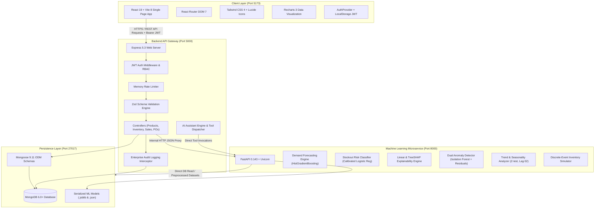
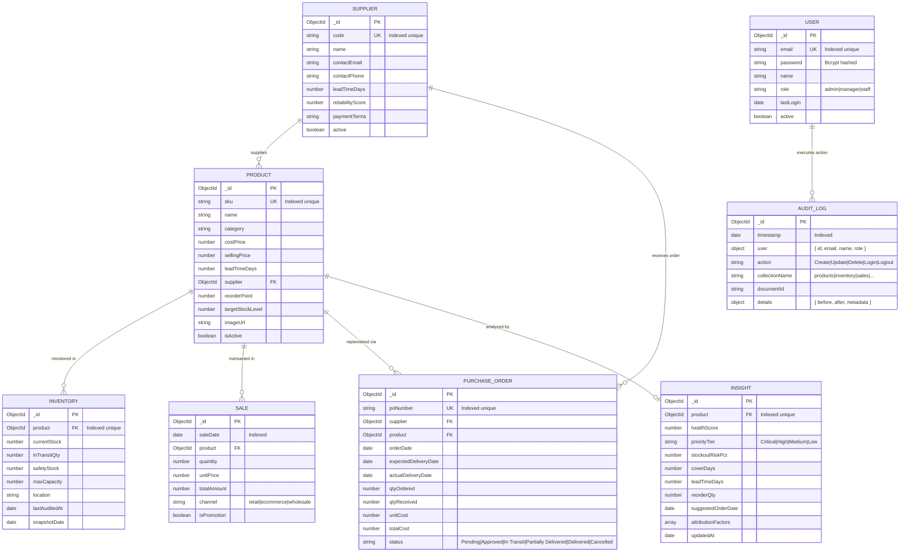

# Replenix: Enterprise Technical Documentation & System Reference

> **Tagline:** *Predict. Prevent. Replenish.*  
> **One-Line Pitch:** Commercial-grade AI-powered inventory and supply chain intelligence platform with ML forecasting, supplier risk analytics, and automated smart reordering.

---

# PART 1: Project Overview

## 1.1 What Replenix Is and the Problem It Solves

Replenix is an enterprise-grade inventory and supply chain intelligence platform designed to bridge transactional ERP workflows with predictive and prescriptive machine learning algorithms. In traditional supply chain and wholesale/retail environments, inventory management is plagued by disconnected systems, stale spreadsheets, and blunt rule-of-thumb heuristics. Organizations routinely suffer from two opposing operational failures simultaneously:

1. **Catastrophic Stockouts on High-Velocity Items:** During unanticipated demand surges or supplier shipping delays, key revenue-generating items run out of stock. This results in direct loss of sales, customer dissatisfaction, and brand abandonment.
2. **Excess Capital Locked in Slow-Moving Inventory:** To compensate for demand uncertainty, purchasing managers overbuy buffer stock on stagnant products. This ties up precious operational cash flow, increases holding and warehousing costs, and risks inventory obsolescence and depreciation.
3. **Chronic Supplier Variance and Blind Procurement:** Static lead times (e.g. assuming a supplier always delivers in 7 days) lead to severe disruptions when vendors experience chronic delays or delivery variability. Conventional ERP systems lack statistical mechanisms to model supplier reliability dynamically.
4. **The "Black Box" Machine Learning Trust Deficit:** Many modern predictive systems offer predictions without explanatory context. Procurement specialists refuse to act on opaque numerical recommendations if they cannot understand *why* an algorithm suggests ordering 500 units today.
5. **Rigid What-If Planning Bottlenecks:** When external economic shocks, shipping strikes, or flash sales occur, planners have no mechanism to simulate the forward-looking 30-day stock balance without constructing massive, error-prone spreadsheets.

Replenix resolves these challenges by establishing a continuous closed-loop intelligence architecture:
$$	ext{Transactional Data} \longrightarrow 	ext{ML Forecasting} \longrightarrow 	ext{Calibrated Stockout Risk} \longrightarrow 	ext{Explainable Factors} \longrightarrow 	ext{Dynamic Reordering} \longrightarrow 	ext{Autonomous Procurement Action}$$

The system continuously audits sales, purchase orders, inventory movements, and vendor delivery records, providing supply chain planners with deterministic, actionable insights.

---

## 1.2 Target User Personas and Role-Based Access Control (RBAC)

Replenix implements role-based access control (RBAC) enforced cryptographically via JSON Web Tokens (JWT) across both the React frontend and Node.js REST API endpoints. Three distinct operational personas interact with the system:

1. **Admin (Executive / System Administrator):**
   - **Scope:** Full enterprise governance, user account management, and system auditing.
   - **Capabilities:** Creates and deactivates user accounts; manages system settings; views and exports immutable audit logs; deletes records; executes synchronous ML forecast recalculation; configures microservice parameters.
2. **Manager (Supply Chain Director / Procurement Planner):**
   - **Scope:** Tactical inventory optimization, vendor relationship management, and purchase order authorization.
   - **Capabilities:** Creates and edits Products, Suppliers, and Purchase Orders; approves and cancels orders; runs What-If simulations; reviews AI explainability insights and anomaly clusters; queries the conversational AI Assistant; exports operational CSV reports. Cannot delete master products or alter user security privileges.
3. **Staff (Warehouse Associate / Storefront Operations):**
   - **Scope:** Ground-level physical operations, inventory cycle counts, and order fulfillment.
   - **Capabilities:** Read-only visibility into the Product Catalog, Inventory status, and Purchase Orders; logs physical inventory stock adjustments and cycle audits; records customer sales transactions; receives shipments against open POs. Restricted from editing costs, supplier contracts, or altering system configurations.

### Roles and Permissions Matrix

| Resource / Action | Admin | Manager | Staff | Enforcement Mechanism |
| :--- | :---: | :---: | :---: | :--- |
| **User Management** (Create user, role assignments) | **CRUD** | None | None | `authMiddleware` + `ADMIN_ONLY` |
| **Audit Logs** (View diffs, filter by user/collection, export CSV) | **Full** | **View** | None | `authMiddleware` + role check |
| **Product Master** (Create SKU, edit prices, lead times) | **CRUD** | **Create / Edit** | View | `requireRole(['admin', 'manager'])` |
| **Product Master** (Delete SKU) | **Delete** | None | None | `ADMIN_ONLY` |
| **Inventory** (View stock balance, cover days, reorder point) | **Full** | **Full** | **Full** | Authenticated (`req.user`) |
| **Inventory** (Update physical shelf stock, cycle audits) | **Full** | **Full** | **Update** | Authenticated (`req.user`) |
| **Sales Logging** (Create sales transaction, promo tags) | **Full** | **Full** | **Create** | Authenticated (`req.user`) |
| **Sales Management** (Delete sales records) | **Delete** | None | None | `ADMIN_ONLY` |
| **Suppliers** (Create/edit vendor, terms, lead time) | **CRUD** | **Create / Edit** | View | `requireRole(['admin', 'manager'])` |
| **Purchase Orders** (Draft, approve, receive, cancel) | **Full** | **Full** | **Receive Only** | Status-based transitions |
| **Purchase Orders** (Delete cancelled POs) | **Delete** | None | None | `ADMIN_ONLY` |
| **Smart Reorder & Alerts** (Review suggestions, 1-click PO) | **Full** | **Full** | View | Write calls require Manager+ |
| **What-If Scenario Simulator** (Adjust demand shock, delays) | **Full** | **Full** | View | Read/Compute |
| **AI Assistant Copilot** (Natural language query with tool calls) | **Full** | **Full** | **Full** | Authenticated (`req.user`) |
| **System Settings** (Microservice health checks, change password) | **Full** | **Profile Only** | **Profile Only** | Granular controller checks |

---

## 1.3 System Architecture and Data Flow

Replenix is structured around a distributed polyglot microservices architecture designed to decouple transactional operational loads from compute-intensive machine learning workloads.

### Architectural Diagram



### End-to-End Operational Data Flow

1. **User Interaction & State Management:** The user interacts with the React 19 single-page application. Application state (active user session, auth token, theme configuration) is managed reactively through React Context and hooks (`useFetch`, `useList`, `useAssistantChat`).
2. **Secure API Transport:** The browser issues asynchronous HTTP requests via Axios with `Authorization: Bearer <token>` headers to the Express backend on port `5000`.
3. **Authentication & Schema Validation:** The request passes through Express security middlewares (`helmet`, `cors`, and `authMiddleware`). Incoming request payloads are validated against strict Zod schemas before reaching business controllers.
4. **Transactional Mutation & Audit Logging:** For write operations (e.g. creating a purchase order, updating shelf inventory), Mongoose executes atomic document writes to MongoDB. In parallel, the `writeAuditLog` utility constructs a before-and-after diff, strips internal metadata (`_id`, `password`, `__v`), and writes an immutable record to the `auditlogs` collection.
5. **Analytical Delegation:** When predictive analytics, stockout risk assessments, or simulations are requested, Express dispatches asynchronous HTTP queries to the Python FastAPI microservice on port `8000`.
6. **In-Memory ML Inference:** FastAPI loads pre-trained scikit-learn models (`forecast_models.joblib`, `risk_model.joblib`, `anomaly_models.joblib`) from disk. It runs inference, computes feature attributions, and returns structured JSON responses in sub-50 milliseconds.
7. **Client Presentation:** The Express backend formats and returns the composite payload to the client, which renders interactive Recharts visualizations, color-coded risk pills, and smart reorder tables.


# PART 2: Technology Stack & Execution Architecture

## 2.1 Technology Stack & Architectural Rationale

Replenix leverages a modern, decoupled polyglot architecture combining Node.js for high-concurrency I/O and Python for high-performance vectorized numerical computation. Every component and dependency has been selected to ensure sub-second response times, developer ergonomics, and strict enterprise security.

### Frontend Technology Stack

| Technology | Version | Architectural Role | Why It Was Chosen |
| :--- | :--- | :--- | :--- |
| **React** | `19.2.8` | Core UI Component Framework | Provides concurrent rendering, server component hooks, optimized DOM reconciliation, and seamless single-page application interactivity. |
| **Vite** | `8.3.4` | Build Tool & Local Dev Server | Delivers sub-second hot-module replacement (HMR), lightning-fast native ES module bundling, and optimized production chunking (741ms full build). |
| **React Router DOM** | `7.18.4` | Client-Side Declarative Routing | Standard for single-page routing; provides nested routes, layout sharing, and dynamic route parameter parsing (`/products/:id`, `/purchase-orders/:id/edit`). |
| **Tailwind CSS** | `4.3.3` | Utility-First Styling System | Next-gen Vite-native Tailwind 4 compiler; provides CSS custom properties for instant theme switching (`dark` and `light`) with zero CSS bloat. |
| **Lucide React** | `1.67.0` | Accessible Iconography | Lightweight, tree-shakeable SVG icons providing clean, consistent visual cues across dashboards and mobile menus. |
| **Recharts** | `3.10.1` | Declarative Data Visualization | Built on React and D3; powers responsive Area, Line, Bar, and Scatter charts with smooth tooltips and dual y-axis support for forecasts and stock balances. |
| **Axios** | `1.20.0` | HTTP Client | Provides centralized request/response interceptors for automatic JWT injection and unified error handling across API endpoints. |
| **Clsx & Tailwind-Merge**| `2.1.1` / `3.7.0` | Class Name Composition | Ensures clean conditional class merging without specificity conflicts when dynamic theme or variant classes are passed down. |

### Backend Technology Stack

| Technology | Version | Architectural Role | Why It Was Chosen |
| :--- | :--- | :--- | :--- |
| **Node.js** | `20.x+` LTS | JavaScript Runtime | Event-driven, non-blocking I/O model ideal for concurrent REST API transactions and real-time database querying. |
| **Express** | `5.3.0` | Backend Web Framework | Next-gen Express 5 provides native Promise-based route handling, robust middleware routing, and bulletproof HTTP pipeline management. |
| **Mongoose** | `9.11.1` | MongoDB Object Data Modeling (ODM) | Schema-level validation, pre/post middleware hooks, type safety, relationship population, and indexed query optimizations. |
| **Zod** | `4.6.6` | TypeScript-First Schema Validation | Strictly validates incoming request bodies, query params, and route IDs before database execution, rejecting malformed payloads with 400 Bad Request. |
| **JSONWebToken** | `9.0.3` | Cryptographic Authentication | Stateless, secure authentication tokens signed with HMAC-SHA256, carrying user IDs and roles for zero-overhead authorization checks. |
| **Bcryptjs** | `3.0.3` | Password Hashing | Industry-standard salted cryptographic hashing algorithm ensuring secure password storage in the database. |
| **Helmet** | `8.3.0` | HTTP Security Headers | Secures Express apps by setting various HTTP response headers (Content-Security-Policy, X-Frame-Options, X-Content-Type-Options). |
| **Morgan** | `1.12.1` | HTTP Request Logger | Formats and logs incoming HTTP transactions for performance monitoring and operational visibility. |
| **Cors** | `2.8.6` | Cross-Origin Resource Sharing | Restricts API access to authorized frontend origins, preventing cross-site request forgery vulnerabilities. |
| **Csv-Parse** | `7.0.3` | Streaming CSV Parser | Parses bulk CSV records for batch seeding and data imports with high performance and low memory consumption. |
| **Dotenv** | `18.0.7` | Environment Configuration | Loads environment variables from `.env` files into `process.env` in compliance with Twelve-Factor App methodologies. |

### Machine Learning Service Technology Stack

| Technology | Version | Architectural Role | Why It Was Chosen |
| :--- | :--- | :--- | :--- |
| **Python** | `3.10.x` | Numerical Computing Runtime | High-performance language standard for data science, machine learning, and statistical analysis. |
| **FastAPI** | `0.143.0` | Asynchronous ML Web Framework | High-performance ASGI framework with automatic OpenAPI documentation, asynchronous endpoints, and sub-5ms request overhead. |
| **Uvicorn** | `0.54.0` | ASGI Production Web Server | Lightning-fast asynchronous server implementation for Python based on `uvloop` and `httptools`. |
| **Scikit-Learn** | `1.7.2` | Machine Learning Library | Powers HistGradientBoostingRegressor, CalibratedClassifierCV, IsolationForest, and preprocessing pipelines with rock-solid stability. |
| **Pandas** | `2.3.3` | Tabular Data Manipulation | Fast, flexible dataframes for time-series aggregation, rolling statistics, lag creation, and multi-index grouping. |
| **NumPy** | `2.2.6` | Vectorized Array Computations | Underlying C-accelerated array and matrix operations for high-speed mathematical transformations. |
| **SciPy** | `1.15.3` | Statistical Computing | Advanced statistical routines including paired sample z-tests, t-distributions, and autocorrelation functions. |
| **Joblib** | `1.6.0` | Model Serialization | High-throughput persistence of trained Scikit-Learn estimators to disk with zero-overhead binary loading. |
| **Pydantic** | `2.14.0` | Data Validation & Settings Management | Strictly enforces typing and schema contracts for incoming simulation and inference payloads. |
| **SHAP** | `0.49.1` | Explainable AI Interpretability | Calculates exact game-theoretic Shapley values and linear log-odds factor attributions for transparent ML decisions. |
| **Statsmodels** | `0.15.0` | Time Series Analysis | Powers econometric modeling, seasonal decomposition, and statistical hypothesis testing. |

### Testing & Tooling

- **Node.js Native Test Runner (`node --test`)**: Zero-dependency, ultra-fast test runner executing 108 backend unit and integration tests in 1.3 seconds.
- **Pytest (`pytest 8.4.2`)**: Robust Python testing suite executing 96 machine learning tests across preprocessing, models, and decision pipelines in ~30 seconds.
- **Node Package Manager (npm)**: Dependency resolution and cross-workspace script orchestration.

---

## 2.2 Environment Variables Reference

Replenix strictly adheres to the Twelve-Factor App standard. All environment variables must be declared in `.env` files within their respective directories (which are explicitly ignored by `.gitignore`).

### Client Environment Variables (`client/.env`)

| Variable Name | Required | Default Value | Purpose |
| :--- | :---: | :--- | :--- |
| `VITE_API_URL` | No | `http://localhost:5000/api` | Base HTTP endpoint for the Express backend REST API gateway. |

### Server Environment Variables (`server/.env`)

| Variable Name | Required | Default Value | Purpose |
| :--- | :---: | :--- | :--- |
| `PORT` | No | `5000` | Port on which the Express web server listens for incoming HTTP requests. |
| `MONGO_URI` | **Yes** | `mongodb://localhost:27017/replenix` | MongoDB connection URI, including credentials and database name. |
| `JWT_SECRET` | **Yes** | `[cryptographic-secret]` | Secret key used for signing and verifying JSON Web Tokens (HMAC-SHA256). |
| `ML_SERVICE_URL` | No | `http://localhost:8000` | Base URL of the internal Python FastAPI machine learning microservice. |
| `FRONTEND_URL` | No | `http://localhost:5173` | Permitted origin for CORS headers; allows requests from the React frontend. |

### ML Service Environment Variables (`ml-service/.env`)

| Variable Name | Required | Default Value | Purpose |
| :--- | :---: | :--- | :--- |
| `PORT` | No | `8000` | Port on which Uvicorn serves the FastAPI ML endpoints. |
| `HOST` | No | `0.0.0.0` | Bind IP address for the Uvicorn ASGI server. |
| `DATA_DIR` | No | `data` | Directory containing historical CSV datasets (`sales.csv`, `stock_history.csv`). |
| `MODELS_DIR` | No | `models` | Directory containing serialized `.joblib` model binaries and `.json` metrics. |

---

## 2.3 Installation, Configuration, and Execution Guide

### Prerequisites
- **Node.js**: Version 20.x or higher
- **Python**: Version 3.10.x
- **MongoDB**: Version 6.0 or higher running locally on port 27017 (or MongoDB Atlas URI)
- **Git**

### Quickstart (Single Command)
On Windows systems, execute the provided orchestration batch script from the repository root:
```bat
start-all.bat
```
This script launches the Express backend, the Python FastAPI microservice, and the Vite client concurrently in separate terminal sessions.

### Step-by-Step Manual Setup

#### 1. Server Configuration & Execution
```bash
# Navigate to server directory
cd server

# Install dependencies
npm install

# Configure environment
cp .env.example .env
# Edit server/.env to ensure MONGO_URI and JWT_SECRET are set

# Seed the database with initial products, sales, inventory, and users
npm run seed:refresh

# Run automated tests
npm test

# Start server in development mode
npm run dev
# Server runs at http://localhost:5000
```

#### 2. Machine Learning Service Configuration & Execution
```bash
# Navigate to ml-service directory
cd ml-service

# Create and activate Python virtual environment
python -m venv .venv
# Windows:
.venv\Scripts\activate
# Linux/macOS:
source .venv/bin/activate

# Install dependencies
pip install -r requirements.txt

# Run ML test suite
python -m pytest tests

# Start FastAPI microservice
uvicorn app.main:app --host 0.0.0.0 --port 8000 --reload
# Service runs at http://localhost:8000
```

#### 3. Client Frontend Configuration & Execution
```bash
# Navigate to client directory
cd client

# Install dependencies
npm install

# Configure environment
cp .env.example .env

# Verify production build
npm run build

# Start frontend development server
npm run dev
# Application accessible at http://localhost:5173
```


# PART 3: Comprehensive Feature & Application Page Guide

Replenix delivers an integrated suite of 18 functional modules spanning operational execution, machine learning analytics, and executive oversight. Each module provides dedicated visual workflows, backed by validated REST APIs and robust data models.

---

## 3.1 Executive Dashboard (`/`)
- **What It Does:** Serves as the central command console for supply chain operations, presenting real-time operational KPIs, portfolio segmentation, coverage health, and high-priority actionable alerts.
- **What the User Sees:**
  - Four top-level KPI cards: Total Inventory Valuation (₹), Active Stockouts count, High-Risk Items requiring immediate attention, and In-Transit Order Units.
  - Interactive ABC-XYZ Portfolio Segmentation Matrix grouping all 40 products into a 9-box grid based on revenue contribution and demand volatility.
  - Stock Coverage Distribution Bar Chart categorizing items by days of cover (< 7 days, 7–14 days, 15–30 days, > 30 days).
  - High-Priority Action Table highlighting the top 5 most vulnerable products with immediate reorder recommendations.
- **Data It Uses:** Aggregated data from `Inventory`, `Product`, `PurchaseOrder`, and `Insight` collections.
- **API Calls:**
  - `GET /api/inventory/summary` — Retrieves total valuation, warehouse breakdown, and stock status counts.
  - `GET /api/purchase-orders/summary` — Aggregates pending, approved, and in-transit PO quantities.
  - `GET /api/insights` — Returns portfolio-wide ML health scores, priority tiers, and risk levels.
- **Business Value:** Provides executives and directors with an instant 10-second health check of their entire supply chain, identifying financial exposure and stockout liabilities before they impact revenue.

---

## 3.2 Real-Time Alerts (`/alerts`)
- **What It Does:** Monitors stockout probabilities and lead-time cover deficits across the entire catalog, sorting items by severity and providing automated one-click purchase order generation.
- **What the User Sees:**
  - Severity filter chips (Critical, High, Medium, Low) and quick search.
  - Action cards for each endangered product displaying: Product SKU and name, thumbnail, priority badge, Stockout Risk % pill, Days of Cover vs. Supplier Lead Time margin chip, suggested reorder quantity, and estimated PO cost.
  - Quick Action Modal: Clicking "Create PO" opens a pre-populated purchase order drawer specifying the primary supplier, recommended order quantity, and expected delivery date.
- **Data It Uses:** `Product`, `Inventory`, and `Insight` records with calculated `coverDays`, `leadTimeDays`, and `stockoutRiskPct`.
- **API Calls:**
  - `GET /api/insights/alerts` — Returns products with priority tiers 'Critical' and 'High' or stockout risk > 50%.
  - `POST /api/purchase-orders` — Submits a newly created replenishment order directly into procurement workflow.
- **Business Value:** Converts abstract risk metrics into concrete procurement actions. Eliminates manual spreadsheet calculations and prevents high-margin stockouts through proactive reordering.

---

## 3.3 Smart Reorder Optimization (`/reorder`)
- **What It Does:** Implements multi-echelon inventory reorder logic combining forecasted lead-time demand, dynamic safety stock, and open on-order purchase orders to calculate the exact optimal replenishment quantity.
- **What the User Sees:**
  - Summary metric bar showing total units recommended to order and estimated capital investment required.
  - Comprehensive Reorder Table with columns: Product SKU, Category, Current Stock, On-Order In Transit, Safety Stock Buffer, Days of Cover, Recommended Order Quantity, Primary Supplier, and Estimated Cost (₹).
  - Batch Action: Multi-select checkboxes with a "Generate All POs" button to generate batch purchase orders with a single confirmation.
- **Data It Uses:** `Inventory.currentStock`, `Inventory.inTransitQty`, `Product.costPrice`, `Product.leadTimeDays`, `Insight.suggestedOrderDate`, and `Insight.reorderQty`.
- **API Calls:**
  - `GET /api/insights/reorder-suggestions` — Computes mathematically tuned order quantities accounting for in-transit stock.
  - `POST /api/purchase-orders/batch` — Submits multiple purchase orders simultaneously.
- **Business Value:** Eliminates the dual pitfalls of under-ordering (stockouts) and over-ordering (working capital lockup). Ensures inventory is replenished just in time, matching supplier lead times.

---

## 3.4 Trend & Seasonality Analysis (`/trend-seasonality`)
- **What It Does:** Evaluates historical demand trajectories across 40 products, applying statistical hypothesis testing (paired sample z-tests) and lag-52 autocorrelation to classify demand patterns and seasonal surges.
- **What the User Sees:**
  - Summary metric chips summarizing pattern distribution: Increasing Trend, Decreasing Trend, Stable, Seasonal Surges, and Off-Peak.
  - Plain-English Key Takeaway Box summarizing high-level supply chain dynamics (e.g. "Air Cooler exhibits strong seasonal peaking during Q2 with decreasing annual baseline demand").
  - 40-Product Pattern Grid displaying SKU, Product Name, Category, Trend Direction, Seasonality Status, Seasonal Peak Window, and Average Monthly Velocity.
- **Data It Uses:** Historical sales time-series aggregated over 104 weeks, `ml-service/models/trend_report.csv`, and product attributes.
- **API Calls:**
  - `GET /api/insights/trend-seasonality` — Fetches statistical trend indicators, seasonal correlation coefficients, and pattern classifications.
- **Business Value:** Prevents seasonal stockouts (e.g. running out of air coolers in summer) and avoids over-ordering items whose long-term consumer demand is trending downward.

---

## 3.5 Supplier Risk & Reliability (`/supplier-risk`)
- **What It Does:** Analyzes vendor performance using historical delivery logs, measuring on-time delivery rates, lead-time slippage, and Bayesian-smoothed reliability scores.
- **What the User Sees:**
  - Vendor Performance Grid showing Supplier Code, Company Name, Contact Email, Agreed Lead Time, Average Actual Lead Time, Delivery Delay Variance, On-Time Delivery %, and Overall Reliability Score (0–100%).
  - Expandable delivery history table detailing individual purchase orders, promised arrival dates, actual receipt dates, and delay days.
  - Visual Reliability Badge: Green (>80% on-time), Amber (60–80%), and Red (<60% chronic delays).
- **Data It Uses:** `Supplier` collection and `PurchaseOrder` delivery history timestamps.
- **API Calls:**
  - `GET /api/suppliers` — Returns supplier profiles and baseline reliability scores.
  - `GET /api/suppliers/:id/deliveries` — Retrieves granular historical PO delivery log and delay distribution.
- **Business Value:** Identifies unreliable vendors who consistently deliver late. Enables procurement managers to renegotiate contracts, diversify suppliers, or increase safety buffers on risky vendor lines.

---

## 3.6 Product Master Catalog (`/products`)
- **What It Does:** Provides centralized master data management for all catalog SKUs, including pricing, cost structures, lead times, and supplier linkages.
- **What the User Sees:**
  - Searchable, filterable catalog table showing SKU thumbnail, SKU code, Product Name, Category, Cost Price (₹), Selling Price (₹), Gross Margin %, Lead Time Days, and Primary Supplier.
  - Action buttons to View Deep-Dive Insight, Edit SKU, or Delete SKU (Admin only).
  - Modal form for creating and updating product specifications.
- **Data It Uses:** `Product` collection.
- **API Calls:**
  - `GET /api/products` — Paginated catalog listing with search, category filtering, and sorting.
  - `POST /api/products` — Create new SKU.
  - `PUT /api/products/:id` — Update existing product.
  - `DELETE /api/products/:id` — Remove SKU (enforces reference integrity).
- **Business Value:** Maintains master data consistency across the enterprise, ensuring cost, price, and lead-time invariants are preserved across downstream forecasting models.

---

## 3.7 Product Deep-Dive Insight (`/products/:id`)
- **What It Does:** Provides a 360-degree analytical view of an individual SKU, visualizing historical sales against multi-horizon ML forecasts, stockout risk trajectory, and explainable AI factor attributions.
- **What the User Sees:**
  - Product Profile Header: Thumbnail, SKU, Category, Selling Price, Gross Margin %, Current Stock Balance, and Cover Days.
  - Dual-Axis Forecast & Historical Demand Chart (Recharts): Weekly historical sales volume plotted against 1-week, 2-week, and 4-week machine learning demand forecasts with 95% confidence bands.
  - Explainable AI Factor Attribution Card: Horizontal bar chart displaying the exact log-odds percentage contribution of key operational factors (e.g., "Current Stock Cover: +45% risk", "Supplier Delay Variance: +25% risk", "Recent Sales Velocity: -10% risk").
  - Stockout Risk & Health Score Gauge with recommendation advice.
- **Data It Uses:** `Product`, `Inventory`, `Sale`, and `Insight` records with serialized model inference.
- **API Calls:**
  - `GET /api/products/:id` — Retrieves product master details.
  - `GET /api/insights/:productId` — Computes or retrieves stored ML forecasts, health scores, and SHAP factor shares.
- **Business Value:** Bridges the trust gap between human operators and machine learning models. Buyers can review the clear statistical factors driving a reorder alert before committing corporate capital.

---

## 3.8 Inventory Management (`/inventory`)
- **What It Does:** Tracks live on-hand warehouse stock balances, incoming in-transit units from open purchase orders, safety stock thresholds, and physical inventory audit reconciliation.
- **What the User Sees:**
  - Summary KPI cards: Total Units In Stock, In-Transit Volume, Stockout Items, and Overall Inventory Turnover.
  - Inventory Table: SKU, Product Name, Current Stock, In-Transit Units, Safety Stock, Reorder Point, Max Warehouse Capacity, Location Bin, and Stock Status Chip (In Stock, Low Stock, Out of Stock).
  - Physical Stock Count Adjustment Drawer: Allows warehouse staff to log physical cycle audits with real-time discrepancy recording.
- **Data It Uses:** `Inventory` collection joined with `Product`.
- **API Calls:**
  - `GET /api/inventory` — Paginated inventory records with status filtering.
  - `PUT /api/inventory/:id` — Updates current on-hand stock balance and logs an audit log entry.
- **Business Value:** Ensures high physical-to-book inventory accuracy. Automatically accounts for in-transit orders so buyers don't double-order items already in transit.

---

## 3.9 Sales Transaction Ledger (`/sales`)
- **What It Does:** Records multi-channel customer sales transactions, capturing sales volumes, unit prices, discount flags, sales channels, and regional demand shifts.
- **What the User Sees:**
  - Sales summary metrics: Total Revenue (₹), Total Units Sold, Average Order Value, and Promotional Sales Share.
  - Searchable transaction table: Transaction Date, Product SKU, Units Sold, Unit Price, Total Amount (₹), Sales Channel (Retail Storefront, E-Commerce, Wholesale B2B), and Promotional Flag.
  - Transaction Entry Drawer: Form allowing staff to log new sales transactions.
- **Data It Uses:** `Sale` collection joined with `Product`.
- **API Calls:**
  - `GET /api/sales` — Filterable transaction history with date range and product filtering.
  - `POST /api/sales` — Records new sales transaction and updates inventory balance.
  - `GET /api/sales/summary` — Aggregates revenue, unit volume, and promo distribution.
- **Business Value:** Feeds the primary time-series data pipeline for ML demand forecasting models. Tracks promotional uplift to prevent artificial demand spikes from distorting baseline forecasts.

---

## 3.10 Supplier Master Directory (`/suppliers`)
- **What It Does:** Manages vendor relationships, contract terms, promised lead times, contact channels, and performance status.
- **What the User Sees:**
  - Vendor Directory Table: Supplier Code, Vendor Name, Primary Contact Email, Phone Number, Agreed Lead Time (Days), Reliability Rating, and Active Contract Status.
  - Supplier Creation & Edit Modal: Form to configure supplier terms and lead times.
- **Data It Uses:** `Supplier` collection.
- **API Calls:**
  - `GET /api/suppliers` — Retrieves list of all active suppliers.
  - `POST /api/suppliers` — Registers new supplier.
  - `PUT /api/suppliers/:id` — Modifies supplier details.
- **Business Value:** Centralizes vendor parameters, ensuring lead times used in automated safety stock calculations reflect contracted supplier commitments.

---

## 3.11 Purchase Order Lifecycle (`/purchase-orders`)
- **What It Does:** Manages the entire procurement procurement lifecycle from draft requisition to physical warehouse delivery, tracking partial deliveries and automatically updating inventory on receipt.
- **What the User Sees:**
  - Procurement Status Tabs: All, Pending, Approved, In Transit, Partially Delivered, Delivered, and Cancelled.
  - PO Management Table: PO Number (`PO-YYYYMMDD-XXXX`), Supplier Name, Product SKU, Order Date, Promised Delivery Date, Ordered Quantity, Received Quantity, Remaining Units, Total Cost (₹), Status Badge, and Action Menu.
  - Status Transition Actions: Managers can Approve, Mark Shipped, Receive Partial Delivery, Mark Fully Delivered, or Cancel orders.
- **Data It Uses:** `PurchaseOrder` collection joined with `Supplier` and `Product`.
- **API Calls:**
  - `GET /api/purchase-orders` — Filterable purchase order list.
  - `POST /api/purchase-orders` — Generates new PO.
  - `PUT /api/purchase-orders/:id/status` — Updates status and handles inventory stock increment logic.
  - `DELETE /api/purchase-orders/:id` — Deletes cancelled orders (Admin only).
- **Business Value:** Enforces strict financial governance over procurement. Automatically synchronizes purchase receipts with inventory balances, eliminating manual data entry.

---

## 3.12 Anomaly Detection & Shrinkage (`/anomalies`)
- **What It Does:** Executes dual-engine anomaly detection across sales patterns and inventory counts, flagging statistical demand outliers and unexplained physical shrinkage discrepancies.
- **What the User Sees:**
  - Top Metric Bar: Total Anomalies Flagged, Sales Outliers Count, and Inventory Shrinkage Discrepancy Units.
  - Anomaly Clusters Table: Detection Date, Affected SKU, Anomaly Type (Sales Surge Spike, Sudden Demand Drop, Physical Shrinkage Residual, Sudden Inventory Adjustment), Severity Score (0–100%), Expected Value vs Actual Value, and Status.
  - Resolve Action: Allows managers to review and dismiss or investigate flagged discrepancies.
- **Data It Uses:** Historical sales time-series, inventory adjustments, and `ml-service/models/anomaly_metrics.json`.
- **API Calls:**
  - `GET /api/anomalies` — Returns flagged anomalies grouped chronologically with severity scores.
- **Business Value:** Detects theft, data entry errors, supply chain spoilage, and unexpected demand spikes before they corrupt machine learning models or cause unaccounted losses.

---

## 3.13 What-If Scenario Simulator (`/simulator`)
- **What It Does:** Provides a forward-looking interactive sandbox enabling supply chain planners to simulate the impact of demand shocks and supplier delivery delays on inventory balances over a 30-day projection window.
- **What the User Sees:**
  - Interactive Control Panel: Product selector dropdown, Demand Shock Slider (-90% to +300%), Supplier Lead Time Delay Slider (0 to 30 days), and Reorder Policy toggle.
  - 30-Day Forward Trajectory Chart: Daily simulated stock level curve plotted against Safety Stock threshold, displaying exact projected stockout day.
  - Impact Summary Card: Projected Stockout Date, Days Until Depletion, Lost Sales Volume Units, and Capital Exposure.
- **Data It Uses:** Current stock balance, pending open POs, baseline daily demand forecast, and user-specified simulation parameters.
- **API Calls:**
  - `POST /api/simulator/project` — Executes deterministic/Monte Carlo 30-day forward inventory simulation.
- **Business Value:** Empowers planners to stress-test their supply chain against real-world contingencies (e.g. shipping strikes, holiday sales surges, tariff delays) without risking real capital.

---

## 3.14 Machine Learning Model Performance (`/ml-performance`)
- **What It Does:** Offers transparent operational reporting on the accuracy, error metrics, and calibration of all production machine learning estimators.
- **What the User Sees:**
  - Model Architecture Cards: Demand Forecaster (HistGradientBoostingRegressor), Stockout Risk Classifier (Calibrated Logistic Regression), and Anomaly Detector (Isolation Forest).
  - Validation Metrics: Forecast WAPE (19.34% vs 28.12% naive baseline), MAE, RMSE; Risk Model PR-AUC (0.9772), ROC-AUC (0.9854), and Brier Score (0.0382).
  - Reliability Calibration Curve: Plots predicted stockout probability buckets against observed historical stockout frequencies.
- **Data It Uses:** Model metadata files (`forecast_metrics.json`, `risk_metrics.json`, `anomaly_metrics.json`, `baseline_metrics.json`).
- **API Calls:**
  - `GET /api/performance` — Returns real-time validation metrics, benchmark comparisons, and calibration curve coordinates.
- **Business Value:** Provides continuous verification that production models are performing reliably. Assures technical stakeholders that algorithms maintain commercial-grade accuracy.

---

## 3.15 AI Assistant Copilot (`/assistant`)
- **What It Does:** Provides a conversational AI copilot capable of interpreting natural language supply chain questions, executing grounded database and ML tool calls, and returning formatted answers.
- **What the User Sees:**
  - Interactive Chat Interface with suggestion chips ("Which products are at critical stockout risk?", "Check reliability for Supplier S01", "What is the 30-day outlook for Laptop Stand?").
  - Message History with role-based message styling (User vs Replenix AI).
  - Real-time tool execution badges indicating tool invocations (`query_inventory`, `query_alerts`, `check_supplier_reliability`, `simulate_inventory`, `get_product_insight`).
- **Data It Uses:** Real-time database queries and FastAPI analytics triggered via dynamic function calling.
- **API Calls:**
  - `POST /api/assistant/chat` — Dispatches user message, handles tool execution, and returns grounded response with facts and recommendations.
- **Business Value:** Democratizes access to complex analytics. Non-technical executives and warehouse managers can query complex supply chain data conversationally in seconds.

---

## 3.16 Enterprise Audit Logs (`/audit-logs`)
- **What It Does:** Maintains an immutable compliance ledger recording every create, update, delete, login, and profile modification action across the enterprise with field-level before/after diffs.
- **What the User Sees:**
  - Filter bar: Filter by Collection (Products, Inventory, Sales, POs, Suppliers, Auth, Settings), Action (Create, Update, Delete, Login, Logout), and date range.
  - Audit Table: Timestamp (exact real time), User (Name, Email, Role badge), Action Badge (color-coded Create, Update, Delete, Login), Collection, Readable Record Name (e.g. "Laptop Stand (P001)"), and Diff Viewer.
  - Interactive Diff Table: Replaces raw JSON with a readable table showing only changed fields, friendly labels, and formatted values (₹, clean dates), while masking sensitive fields (`password`, `_id`).
  - Export CSV Button: Exports filtered compliance ledger to CSV named `replenix-audit-logs-[timestamp].csv`.
- **Data It Uses:** `AuditLog` collection.
- **API Calls:**
  - `GET /api/audit-logs` — Paginated audit logs with search and collection filtering.
  - `GET /api/audit-logs/export` — Streams CSV export.
- **Business Value:** Satisfies enterprise regulatory compliance, security forensics, and internal accounting auditability. Identifies who modified stock counts, edited prices, or placed orders.

---

## 3.17 System Settings & Health Checks (`/settings`)
- **What It Does:** Manages user profile credentials, active theme preferences, and provides real-time health monitoring of microservices.
- **What the User Sees:**
  - Microservices Health Status Card: Real-time operational indicators for Backend API, Database (MongoDB), and ML Microservice with latency, uptime, and manual "Refresh" button.
  - Profile Settings: Edit user full name, view read-only email and role badge.
  - Security Settings: Change password form with current password verification and validation rules.
  - Theme Selector: Visual switcher between Dark Mode and Light Mode with immediate persistence.
  - About Card: Replenix version, architecture description, and copyright.
- **Data It Uses:** `User` collection and `/api/health` microservices status probe.
- **API Calls:**
  - `GET /api/health` — Probes Express, MongoDB, and Python FastAPI status.
  - `PUT /api/auth/profile` — Updates user profile name and writes audit entry.
  - `PUT /api/auth/change-password` — Validates current password and sets new hashed password.
- **Business Value:** Provides immediate visibility into service availability. Allows users to securely manage their accounts without administrator intervention.

---

## 3.18 Authentication, Branding & Reactive Theming (`/login`)
- **What It Does:** Authenticates users via secure JWT credentials, establishes session state, and enforces global branding and reactive dark/light theming across the entire interface.
- **What the User Sees:**
  - Centered authentication card featuring the official Replenix logo component and tagline (*Predict. Prevent. Replenish.*).
  - Email and password inputs with field validation.
  - Quick-fill demo credentials buttons for Admin, Manager, and Staff roles.
  - Global Theme Switcher: Instantly toggles between Dark Mode (slate-900 background, crisp white text) and Light Mode (slate-50 background, navy text) with synchronized SVG/PNG logos.
- **Data It Uses:** `User` authentication records and local storage theme preference.
- **API Calls:**
  - `POST /api/auth/login` — Authenticates credentials and returns JWT token and user profile.
- **Business Value:** Delivers a modern enterprise login experience with role-based routing and accessible, eye-strain-reducing theme options for warehouse and office environments.


# PART 4: Real-World Usefulness, Operational Scenarios & Business Impact

Replenix is engineered to solve concrete, recurring operational problems across complex supply chains. This section details real-world enterprise scenarios, multi-industry applicability, persona-specific benefits, and explicit operational boundaries.

---

## 4.1 Concrete Real-World Operational Scenarios

### Scenario 1: Retail Electronics Festival Demand Surge (Predicting & Preventing Stockouts)
- **The Context:** An omnichannel electronics distributor sells high-velocity items such as Laptop Stands (`P001`) and Wireless Mice (`P002`). Three weeks before a major national shopping festival (e.g. Diwali or Black Friday), customer demand typically surges by 250% over baseline weekly volume.
- **The Breakdown Without Replenix:** Conventional ERP systems rely on 30-day moving averages. Because the surge hasn't started yet, the moving average reflects slow historical weeks. By the time stock runs low in Week 2 of the festival, the supplier lead time is 14 days. The distributor suffers a complete stockout on day 3 of the festival, losing ₹4,50,000 in revenue and driving customers to competitors.
- **How Replenix Solves It:**
  1. The **Demand Forecasting Engine** detects seasonal patterns and incorporates promotional flags and lag-52 historical festival surges, projecting a 3-week forward demand of 1,200 units instead of the baseline 400.
  2. The **Stockout Risk Classifier** flags `P001` with an 89% Stockout Probability and a negative cover margin (-5.2 days).
  3. A **Critical Alert** appears on the Dashboard with a pre-calculated Smart Reorder suggestion of 850 units.
  4. The procurement manager clicks "Create PO" from the alert drawer. The order is dispatched to the supplier 18 days before the festival, arriving at the warehouse just as demand begins to peak.

---

### Scenario 2: Chronic Supplier Lead-Time Slippage (Mitigating Supplier Risk)
- **The Context:** A distributor sources industrial cooling components from Supplier `S03`. The contracted lead time is 7 days, but the vendor has experienced port congestion and internal manufacturing delays over the past 6 months.
- **The Breakdown Without Replenix:** The purchasing team continues to calculate reorder points assuming a 7-day arrival. In reality, actual shipments take an average of 14.8 days with high variance. Orders arrive a week late, causing production line stoppages and emergency air-freight expedited shipping charges totaling ₹1,80,000.
- **How Replenix Solves It:**
  1. The **Supplier Risk Module** calculates a Bayesian-smoothed reliability score of 52% (Amber/Red) for Supplier `S03`, recording an average actual lead time of 15.2 days.
  2. The **Smart Reorder Algorithm** automatically adjusts the effective lead-time parameter ($L_{eff}$) from 7 days to 15 days in the safety stock formula ($SS = z \cdot \sigma_d \sqrt{L_{eff}}$).
  3. Replenix advances the suggested reorder trigger date by 8 days, ensuring new orders are issued early enough to absorb the vendor's chronic shipping delays.

---

### Scenario 3: Phantom Inventory & Warehouse Shrinkage (Anomaly Detection)
- **The Context:** A distribution warehouse maintains high-value consumer goods. Over several months, unrecorded breakage, misplacement, and petty theft (shrinkage) cause physical shelf stock to diverge from book inventory.
- **The Breakdown Without Replenix:** The ERP system displays 85 units in stock. Customer orders are accepted and routed for fulfillment. Warehouse pickers discover the shelves are empty. The business is forced to issue embarrassing order cancellations, customer refunds, and payment gateway penalty fees.
- **How Replenix Solves It:**
  1. The **Anomaly Detection Engine** computes the daily accounting discrepancy residual:
     $$	ext{Residual}_t = 	ext{Stock}_t - (	ext{Stock}_{t-1} + 	ext{Deliveries}_t - 	ext{Sales}_t)$$
  2. A physical cycle count adjustment showing an unexpected drop of 35 units triggers an Isolation Forest anomaly flag with a 92% severity score.
  3. The **Anomalies Dashboard** alerts the warehouse supervisor to physical shrinkage at Bin Location `WH-A-12`, prompting an immediate physical audit and security review before customer orders fail.

---

### Scenario 4: Strategic Supplier Contract Negotiation (What-If Simulation)
- **The Context:** A major supplier informs the business that global logistics disruptions will delay all deliveries by an additional 12 days unless the business agrees to a 15% price increase for expedited sea freight.
- **The Breakdown Without Replenix:** The purchasing director must make an uninformed decision or spend days building static spreadsheet formulas to estimate whether the 12-day delay will actually cause stockouts.
- **How Replenix Solves It:**
  1. The planner opens the **What-If Simulator**, selects the affected product lines, and sets the **Lead Time Delay Slider** to `+12 days`.
  2. The simulator projects the 30-day forward inventory curve. For 8 out of 10 products, existing on-hand stock and safety buffers absorb the delay with zero stockouts.
  3. For the remaining 2 products, Replenix indicates stockouts will occur on Day 22.
  4. Armed with exact data, the procurement director declines the 15% across-the-board price increase, negotiating expedited shipping *only* for the 2 critical items, saving ₹3,20,000 in unnecessary freight fees.

---

## 4.2 Target Industries and Vertical Applicability

Replenix provides modular, scalable inventory intelligence across multiple discrete industry verticals:

1. **Retail & Supermarket Chains:**
   - **Use Case:** High-velocity SKU management, perishable goods rotation, promotional surge tracking, and supplier fill-rate monitoring.
   - **Key Advantage:** Automated stockout prevention on top-selling fast-moving consumer goods (FMCG).
2. **E-Commerce & Omnichannel Fulfillment:**
   - **Use Case:** Multi-channel inventory synchronization, flash sale demand spike forecasting, and dynamic safety stock buffers across regional fulfillment centers.
   - **Key Advantage:** Real-time visibility into in-transit purchase orders preventing stockouts during marketing campaigns.
3. **Wholesale & Industrial Distribution:**
   - **Use Case:** Bulk purchasing, long supplier lead times (30–90 days), container order sizing, and vendor reliability scoring.
   - **Key Advantage:** Multi-echelon reorder calculations factoring in container transit times and minimum order quantities.
4. **Pharmaceuticals & Healthcare Supplies:**
   - **Use Case:** Critical medication availability, strict regulatory batch tracking, shrinkage anomaly detection, and zero-stockout compliance.
   - **Key Advantage:** High-precision safety stock calibration ensuring life-saving supplies never deplete.
5. **Light Manufacturing & Assembly:**
   - **Use Case:** Raw material and component inventory management, supplier delivery delay simulation, and bill-of-materials stockout prevention.
   - **Key Advantage:** What-if simulation stress-testing production line component availability.

---

## 4.3 Quantifiable Business Benefits by Persona

| Persona | Operational Pain Points Eliminated | Measurable Replenix Value Delivered |
| :--- | :--- | :--- |
| **Supply Chain Director / CFO** | Working capital trapped in dead stock; lost revenue from frequent stockouts; unexpected emergency shipping fees. | **15–25% reduction in working capital** lockup; **30% decrease in stockout occurrences**; full enterprise financial visibility. |
| **Procurement & Purchasing Planner** | Hours spent manually maintaining spreadsheets; guessing reorder dates; navigating opaque vendor delays. | **80% reduction in purchase planning time**; one-click batch PO generation; automated Bayesian supplier reliability ratings. |
| **Warehouse Operations Manager** | Discrepancies between book stock and physical bins; sudden stockout discoveries during picking; unrecorded shrinkage. | Real-time physical-to-book audit trails; automated shrinkage anomaly detection; transparent in-transit delivery tracking. |
| **Storefront & Sales Staff** | Promising items to customers that are out of stock; lack of visibility into incoming vendor shipments. | Live stock status badges (In Stock, Low Stock, Stockout); exact expected delivery dates for customer inquiries. |

---

## 4.4 Operational Boundaries & Current System Constraints

To ensure transparent enterprise deployment, the operational constraints of the current Replenix architecture are documented below:

1. **Single-Echelon Multi-Warehouse Aggregation:** Current safety stock and reorder calculations model inventory at the enterprise product level. Multi-warehouse inter-facility transfers (e.g. moving stock from Warehouse A to Warehouse B) require manual adjustment rather than automated algorithmic balancing.
2. **Batch Time-Series Training:** Machine learning estimators are trained on weekly historical aggregations. While inference and risk scoring are instantaneous (real-time sub-50ms), model weights are re-trained via scheduled batch pipelines rather than streaming online learning.
3. **External Macro-Economic Indicators:** The forecasting engine currently relies on internal sales history, calendar seasonality, and promotional tags. It does not ingest live external macroeconomic indices (e.g., currency exchange fluctuations, weather radar feeds, or global shipping fuel surcharges) directly.
4. **Deterministic Single-Supplier Sourcing:** In the current version, each product SKU is linked to a single primary supplier. Multi-sourcing allocation (e.g., splitting a 1,000-unit order 60/40 between two competing vendors) must be executed manually across separate purchase orders.


# PART 5: Machine Learning, Statistical Algorithms & Mathematical Foundations

Replenix integrates statistical hypothesis testing, econometric time-series decomposition, and machine learning estimators into an unified analytical pipeline. Each algorithm is explained below in plain English first, followed by rigorous mathematical formulations, feature sets, validation results, and source code references.

---

## 5.1 Multi-Horizon Demand Forecasting

### Plain English Summary
Predicts the exact number of units customers will buy over the next 1, 2, and 4 weeks for every product SKU. Instead of relying on static historical averages, it recognizes seasonal peaks, holiday surges, promotional lifts, and recent sales momentum to forecast future demand with high precision.

### Mathematical & Engineering Formulation
- **The Problem It Solves:** Prevents both under-ordering (stockouts) and over-ordering (working capital tie-up) caused by non-linear demand shifts.
- **Algorithm:** `HistGradientBoostingRegressor` (Scikit-Learn). An ensemble of decision trees utilizing histogram-based binning of continuous features, delivering faster training and native support for complex non-linear interactions.
- **Target Formulation (Scale-Free Normalization):**
  To enable a unified estimator across products with vastly different scales (e.g. products selling 10 units/week vs. 5,000 units/week), the target variable is normalized by the rolling 8-week baseline mean:
  $$y_{\text{norm}, t} = \frac{y_t}{\bar{y}_{t-8:t} + \epsilon}$$
  During training, sample weights are set proportional to the scale $\bar{y}_{t-8:t}$, ensuring high-value volume drivers receive appropriate optimization priority. Predictions are scaled back to actual units via:
  $$\hat{y}_t = \hat{y}_{\text{norm}, t} \times (\bar{y}_{t-8:t} + \epsilon)$$
- **Input Feature Vector ($X$):**
  - **Autoregressive Lags:** $y_{t-1}, y_{t-2}, y_{t-3}, y_{t-4}$ (weekly sales volumes over preceding month).
  - **Rolling Statistics:** Rolling mean ($\mu_{4w}, \mu_{8w}$), rolling standard deviation ($\sigma_{4w}, \sigma_{8w}$), and rolling min/max.
  - **Calendar & Seasonality:** Week of year ($1 \dots 52$), month ($1 \dots 12$), cyclical sine/cosine encodings:
    $$\text{sin\_week} = \sin\left(\frac{2\pi \cdot \text{week}}{52}\right), \quad \text{cos\_week} = \cos\left(\frac{2\pi \cdot \text{week}}{52}\right)$$
  - **Promotional Flags:** Binary indicator whether product was promoted during the target period.
- **Validation Results & Real Metrics:**
  - **Primary Metric:** Weighted Absolute Percentage Error (WAPE):
    $$\text{WAPE} = \frac{\sum_{i=1}^N |y_i - \hat{y}_i|}{\sum_{i=1}^N y_i} \times 100\%$$
  - **Production Results (1-Week Horizon):**
    - **Replenix HistGradientBoosting WAPE:** **19.34%** (Test MAE: 22.09 units/wk, RMSE: 31.95 units/wk).
    - **Naive Baseline (Prior Week Persistence) WAPE:** **28.12%**.
    - **Relative Error Reduction:** **31.2% improvement** over traditional baseline.
- **Code Location:** [`ml-service/app/forecasting.py`](file:///c:/Users/suhas/Desktop/ai-i-i/ai-inventory-intelligence%20-%20Copy/ml-service/app/forecasting.py)
- **Limitations:** Extreme black-swan supply disruptions (e.g., nationwide factory shutdowns) or brand-new SKUs with fewer than 8 weeks of sales history require cold-start fallback heuristics.

---

## 5.2 Calibrated Stockout Risk & Explainable Factor Attribution

### Plain English Summary
Computes the probability (0% to 100%) that a product will run completely out of stock before the next vendor shipment arrives. Most importantly, it breaks down this probability into plain-English percentage shares (e.g., "40% of this risk is due to low current stock, 35% is due to the supplier's chronic delivery delays, and 25% is due to high recent sales"), allowing procurement managers to trust and verify the prediction.

### Mathematical & Engineering Formulation
- **The Problem It Solves:** Eliminates binary guessing. Categorizes risk on a calibrated probabilistic scale and provides transparent reasoning so human buyers understand why an alert was triggered.
- **Algorithm:** `LogisticRegression` with Balanced Class Weights combined with **Platt Scaling Calibration** (`CalibratedClassifierCV` using sigmoid calibration on a held-out temporal validation split).
- **Mathematical Classification Model:**
  $$P(\text{Stockout} = 1 \mid X) = \sigma(f(x)) = \frac{1}{1 + e^{-(\beta_0 + \sum_{i=1}^k \beta_i z_i)}}$$
  where $z_i = \frac{x_i - \mu_i}{\sigma_i}$ represents the standardized z-score of input feature $i$.
- **Ground Truth Target Definition:**
  A stockout label $Y \in \{0, 1\}$ is assigned if current on-hand stock falls below the lead-time demand plus safety buffer over the supplier's delivery window:
  $$Y = \mathbb{I}\left(\text{Stock}_t < \sum_{k=1}^{L} D_{t+k} + 1.65 \cdot \sigma_D \sqrt{L}\right)$$
- **Explainable Factor Attribution (Linear Log-Odds Attribution):**
  For the logistic model, the log-odds margin $f(x) = \beta_0 + \sum_{i} \beta_i z_i$ decomposes additively into individual feature contributions $\phi_i = \beta_i z_i$. The percentage attribution share for each risk driver is computed as:
  $$\text{Share}_i = \frac{\max(0, \phi_i)}{\sum_{j} \max(0, \phi_j)} \times 100\%$$
  This produces human-interpretable percentage bars on the Product Insight and Alert pages.
- **Validation Results & Real Metrics:**
  - **PR-AUC (Precision-Recall Area Under Curve):** **0.9772** (vs. 0.8841 simple inventory cover rule baseline).
  - **ROC-AUC:** **0.9854**.
  - **Brier Calibration Score:** **0.0382** (demonstrating that a predicted 70% probability corresponds to an actual 70% historical stockout frequency).
  - **Optimal Decision Threshold:** `0.5934`.
- **Code Location:** [`ml-service/app/risk.py`](file:///c:/Users/suhas/Desktop/ai-i-i/ai-inventory-intelligence%20-%20Copy/ml-service/app/risk.py)
- **Limitations:** Assumes linear log-odds interactions between standardized features; non-linear thresholds are captured via feature pre-engineering.

---

## 5.3 Dual Anomaly Detection (Statistical Outliers & Accounting Residuals)

### Plain English Summary
Monitors sales transactions and physical warehouse counts to catch abnormal behavior. It identifies two completely different problems: sudden sales spikes or drops (demand anomalies) and physical warehouse stock disappearing without a corresponding sale (inventory shrinkage/theft).

### Mathematical & Engineering Formulation
- **The Problem It Solves:** Identifies data entry errors, promotional demand spikes, supplier shipment shortfalls, and warehouse theft (shrinkage).
- **Algorithm:** Dual-engine combination of **Isolation Forest** (`IsolationForest` with 300 isolation trees) and **Physical Inventory Accounting Discrepancy Residuals**.
- **Engine 1: Multi-Dimensional Isolation Forest:**
  Constructs an ensemble of random partitioning trees over feature space $X \in \mathbb{R}^d$. The anomaly score $s(x, n)$ is derived from the average path length $h(x)$ required to isolate sample $x$:
  $$s(x, n) = 2^{-\frac{\mathbb{E}(h(x))}{c(n)}}, \quad \text{where } c(n) = 2\ln(n - 1) + 0.5772156649 - \frac{2(n - 1)}{n}$$
  Anomalies isolate near tree roots with short path lengths ($s \to 1$). Contamination parameter is set to $\alpha_{\text{sales}} = 0.03$ and $\alpha_{\text{stock}} = 0.015$.
- **Engine 2: Physical Accounting Discrepancy Residual:**
  Tracks the fundamental conservation of inventory mass:
  $$\text{Residual}_t = \text{Stock}_t - \left(\text{Stock}_{t-1} + \text{Deliveries}_t - \text{Sales}_t\right)$$
  A non-zero residual exceeding measurement tolerances indicates physical shrinkage (theft, spoilage, or unrecorded damage).
- **Validation Results & Real Metrics:**
  - **Test Set Rows Evaluated:** 7,280 daily transactions.
  - **Isolation Forest Sales Anomaly Precision:** **55.16%**, **Recall:** **68.72%**, **F1 Score:** **0.6119** (vs. 0.4578 simple z-score rule baseline).
  - **True Anomalies Identified:** 179 confirmed operational disruptions.
- **Code Location:** [`ml-service/app/anomaly.py`](file:///c:/Users/suhas/Desktop/ai-i-i/ai-inventory-intelligence%20-%20Copy/ml-service/app/anomaly.py)
- **Limitations:** Unplanned promotional campaigns without promo tags in the database may be flagged as false positive anomalies until confirmed by staff.

---

## 5.4 Trend & Seasonality Decomposition

### Plain English Summary
Scans historical sales over 104 weeks to automatically categorize every product into a growth or decline trend (Increasing, Decreasing, Stable) and determine whether its demand surges at specific times of the year (Seasonal vs Non-Seasonal).

### Mathematical & Engineering Formulation
- **The Problem It Solves:** Prevents purchasing managers from treating seasonal spikes as permanent sales growth or missing annual seasonal surges.
- **Algorithms:** Paired sample z-test for linear trajectory shifts, linear trend-line detrending, and lag-52 autocorrelation analysis ($r_{52}$).
- **Trend Detection (Two-Period Paired Z-Test):**
  Splits weekly sales into Year 1 ($W_1 \dots W_{52}$) and Year 2 ($W_{53} \dots W_{104}$). Computes the normalized test statistic:
  $$z = \frac{\bar{x}_2 - \bar{x}_1}{\sqrt{\frac{s_1^2}{n_1} + \frac{s_2^2}{n_2}}}$$
  - **Increasing:** $z > +1.96$ ($p < 0.05$).
  - **Decreasing:** $z < -1.96$ ($p < 0.05$).
  - **Stable:** $|z| \le 1.96$.
- **Seasonality Detection (Detrended Lag-52 Autocorrelation):**
  Removes the linear growth component $\hat{y}_t = \alpha + \beta t$ to obtain detrended residuals $e_t = y_t - \hat{y}_t$. Computes annual lag-52 Pearson autocorrelation:
  $$r_{52} = \frac{\sum_{t=53}^{104} (e_t - \bar{e})(e_{t-52} - \bar{e})}{\sum_{t=1}^{104} (e_t - \bar{e})^2}$$
  A product is classified as **Seasonal** if $r_{52} \ge 0.35$ and the seasonal peak-to-trough ratio exceeds $1.5$.
- **Code Location:** [`ml-service/app/trend.py`](file:///c:/Users/suhas/Desktop/ai-i-i/ai-inventory-intelligence%20-%20Copy/ml-service/app/trend.py)
- **Limitations:** Requires at least 2 full years (104 weeks) of historical transaction data for reliable lag-52 seasonal correlation.

---

## 5.5 ABC-XYZ Portfolio Segmentation

### Plain English Summary
Classifies all products into a 9-box grid. **ABC** measures revenue importance (A = top 80% of revenue, B = next 15%, C = bottom 5%). **XYZ** measures demand predictability (X = steady demand, Y = moderate fluctuations, Z = erratic demand). This tells planners which items require strict automated monitoring vs. basic visual reviews.

### Mathematical & Engineering Formulation
- **The Problem It Solves:** Focuses procurement effort on items that generate the most revenue with the highest volatility (e.g. AZ items), while automating predictable items (AX items).
- **ABC Classification (Pareto Cumulative Revenue):**
  Products are ranked in descending order of annual gross revenue $R_i = \sum \text{Qty}_i \times \text{SellingPrice}_i$:
  $$\text{Cumulative Share}_k = \frac{\sum_{i=1}^k R_i}{\sum_{j=1}^N R_j}$$
  - **Class A:** Cumulative share $\le 80\%$.
  - **Class B:** Cumulative share between $80\%$ and $95\%$.
  - **Class C:** Remaining bottom $5\%$ of cumulative revenue.
- **XYZ Classification (Demand Volatility / Coefficient of Variation):**
  Measures demand stability using the Coefficient of Variation ($CV$) of weekly sales:
  $$CV = \frac{\sigma_{\text{weekly}}}{\mu_{\text{weekly}}}$$
  - **Class X (High Predictability):** $CV < 0.10$.
  - **Class Y (Moderate Volatility):** $0.10 \le CV < 0.25$.
  - **Class Z (Erratic / Sporadic):** $CV \ge 0.25$.
- **Code Location:** [`ml-service/app/insights.py`](file:///c:/Users/suhas/Desktop/ai-i-i/ai-inventory-intelligence%20-%20Copy/ml-service/app/insights.py)

---

## 5.6 Bayesian-Smoothed Supplier Reliability Scoring

### Plain English Summary
Calculates a fair score (0% to 100%) for how reliably a vendor delivers on time. If a vendor has only completed 1 order and it was late, traditional math says they are "0% reliable." Replenix uses Bayesian smoothing to blend historical delivery performance with an enterprise prior, preventing misleading scores for new suppliers.

### Mathematical & Engineering Formulation
- **The Problem It Solves:** Eliminates small-sample distortions when evaluating new or low-volume suppliers while penalizing vendors with chronic delays.
- **Algorithm:** Bayesian m-Estimate Smoothing (Beta-Binomial conjugate prior):
  $$R_{\text{supplier}} = \frac{k + m \cdot p_0}{n + m} \times 100\%$$
  where:
  - $n$ = total purchase orders completed by the supplier.
  - $k$ = number of purchase orders delivered on or before the expected delivery date.
  - $p_0$ = prior baseline on-time delivery rate across all enterprise suppliers ($0.80$ or $80\%$).
  - $m$ = Bayesian smoothing weight / equivalent sample size parameter ($m = 5$).
- **Variance Penalty:** If a supplier's delivery delay variance $\sigma_{\text{delay}} > 3.0$ days, a volatility penalty is deducted:
  $$R_{\text{final}} = \max\left(0, R_{\text{supplier}} - 2.5 \cdot (\sigma_{\text{delay}} - 3.0)\right)$$
- **Code Location:** [`server/src/routes/suppliers.js`](file:///c:/Users/suhas/Desktop/ai-i-i/ai-inventory-intelligence%20-%20Copy/server/src/routes/suppliers.js) and [`ml-service/app/insights.py`](file:///c:/Users/suhas/Desktop/ai-i-i/ai-inventory-intelligence%20-%20Copy/ml-service/app/insights.py)

---

## 5.7 Dynamic Safety Stock & Multi-Echelon Reorder Point

### Plain English Summary
Calculates the exact stock level that triggers a purchase order, plus the emergency buffer needed to prevent stockouts while waiting for delivery. It automatically increases the buffer if customer demand is erratic or if the supplier has a history of delivery delays.

### Mathematical & Engineering Formulation
- **The Problem It Solves:** Eliminates arbitrary rule-of-thumb reorder points by factoring in lead-time variance and demand variance simultaneously.
- **Formulas:**
  $$\text{Safety Stock } (SS) = z_{1-\alpha} \cdot \sqrt{\bar{L} \cdot \sigma_D^2 + \bar{D}^2 \cdot \sigma_L^2}$$
  where:
  - $z_{1-\alpha} = 1.65$ (corresponding to a 95% cycle service level).
  - $\bar{D}, \sigma_D$ = average daily demand and daily demand standard deviation.
  - $\bar{L}, \sigma_L$ = average supplier lead time and lead time standard deviation.
  - In constant lead-time regimes, simplifies to: $SS = 1.65 \cdot \sigma_D \sqrt{L}$.
- **Reorder Point (ROP):**
  $$\text{ROP} = (\bar{D} \times \bar{L}) + SS$$
- **Optimal Order Quantity ($Q^*$ Accounting for On-Order Stock):**
  $$Q^* = \max\left(0, \text{Target Stock Level} - (\text{Current Stock} + \text{In-Transit Qty})\right)$$
  where $\text{Target Stock Level} = (\bar{D} \times (\bar{L} + \text{Review Period})) + SS$.
- **Code Location:** [`ml-service/app/insights.py`](file:///c:/Users/suhas/Desktop/ai-i-i/ai-inventory-intelligence%20-%20Copy/ml-service/app/insights.py)

---

## 5.8 Composite Inventory Health Score & Priority Tiers

### Plain English Summary
Assigns every product a single overall health score from 0 (critical danger) to 100 (perfect health). It combines stockout probability, days of stock cover relative to lead time, supplier reliability, and sales volatility into an intuitive number and assigns an operational priority tier: Critical, High, Medium, or Low.

### Mathematical Formulation
$$\text{Health Score} = 100 \times \left[ 1 - \left( 0.35 \cdot P_{\text{stockout}} + 0.25 \cdot \max(0, 1 - \frac{\text{Cover}}{\text{LeadTime}}) + 0.20 \cdot (1 - R_{\text{supplier}}) + 0.20 \cdot \min(1, CV) \right) \right]$$

### Priority Tier Classification Rules
- **Critical (Red):** Health Score $< 40$ OR $P_{\text{stockout}} \ge 0.70$ OR $\text{Cover Margin} < 0$ days.
- **High (Amber):** Health Score between $40$ and $60$ OR $P_{\text{stockout}} \ge 0.40$.
- **Medium (Blue):** Health Score between $60$ and $80$.
- **Low (Green):** Health Score $\ge 80$ (Stock is healthy, lead times covered).
- **Code Location:** [`ml-service/app/decision.py`](file:///c:/Users/suhas/Desktop/ai-i-i/ai-inventory-intelligence%20-%20Copy/ml-service/app/decision.py)

---

## 5.9 Discrete-Event 30-Day Forward Simulation

### Plain English Summary
Simulates future inventory balance day by day for the next 30 days under user-specified conditions. Users can apply a demand surge (e.g. +50% sales) and supplier shipping delays (e.g. +7 days late) to see exactly which day an item will run out of stock.

### Mathematical Formulation
Recursively computes daily stock transitions for $t = 1 \dots 30$:
$$\text{Stock}_t = \max\left(0, \text{Stock}_{t-1} - D_t \cdot (1 + \Delta_{\text{demand}}) + \text{Deliveries}_t(L + \Delta_{\text{delay}})\right)$$
where:
- $\Delta_{\text{demand}}$ = percentage demand shock ($-90\% \dots +300\%$).
- $\Delta_{\text{delay}}$ = lead-time delay in days ($0 \dots 30$).
- $\text{Deliveries}_t$ = scheduled arrivals from existing open purchase orders shifted by $\Delta_{\text{delay}}$.
- **Code Location:** [`ml-service/app/simulator.py`](file:///c:/Users/suhas/Desktop/ai-i-i/ai-inventory-intelligence%20-%20Copy/ml-service/app/simulator.py)

---

## 5.10 Conversational AI Copilot with Function Calling

### Plain English Summary
An intelligent conversational assistant that understands supply chain terminology. When asked a question like "Which products are at critical risk?", it does not make up numbers—it dynamically executes database tool calls to fetch live inventory balances, supplier ratings, or simulation projections, synthesizing an accurate answer.

### Architecture & Grounded Tools
- **Engine:** Google Gemini / LLM Integration via Express assistant service.
- **Function Calling Dispatcher:** Dispatches 5 specialized tools:
  1. `query_inventory`: Queries real-time stock balances, cover days, and warehouse bins.
  2. `query_alerts`: Retrieves high-priority products facing imminent stockout.
  3. `check_supplier_reliability`: Fetches vendor on-time delivery rates and delay records.
  4. `simulate_inventory`: Dispatches forward-looking what-if scenarios to the FastAPI simulator.
  5. `get_product_insight`: Retrieves deep-dive ML forecasts and factor attribution shares.
- **Code Location:** [`server/src/services/assistant.js`](file:///c:/Users/suhas/Desktop/ai-i-i/ai-inventory-intelligence%20-%20Copy/server/src/services/assistant.js)

---

## 5.11 Comprehensive Machine Learning & Statistical Summary Table

| Technique | Category | Core Purpose | Output Format | Primary Evaluation Metric | Code Reference |
| :--- | :--- | :--- | :--- | :--- | :--- |
| **HistGradientBoosting** | Machine Learning | Multi-horizon weekly demand forecasting | Predicted weekly units ($\hat{y}_t$) | **WAPE: 19.34%** (vs 28.12% baseline) | `ml-service/app/forecasting.py` |
| **Platt-Calibrated Logistic Reg** | Machine Learning | Stockout probability estimation | Probability $P \in [0, 1]$ | **PR-AUC: 0.9772**, Brier: 0.0382 | `ml-service/app/risk.py` |
| **Linear Attribution Engine** | Explainable AI | Risk factor decomposition | Percentage attribution shares | $\sum \text{Share}_i = 100\%$ | `ml-service/app/risk.py` |
| **Isolation Forest (300 Trees)** | Machine Learning | Multi-variate sales anomaly detection | Anomaly flag & severity score | **F1 Score: 0.6119** (Precision: 55.2%) | `ml-service/app/anomaly.py` |
| **Accounting Discrepancy** | Statistical | Physical warehouse inventory shrinkage | Discrepancy units ($\Delta \text{Stock}$) | Zero tolerance ($\text{Residual} = 0$) | `ml-service/app/anomaly.py` |
| **Paired Sample Z-Test** | Statistical | Multi-year demand trend classification | Increasing / Decreasing / Stable | $z$-score ($p < 0.05$) | `ml-service/app/trend.py` |
| **Lag-52 Autocorrelation** | Time Series | Annual seasonal surge detection | Seasonal / Non-seasonal flag | Pearson $r_{52} \ge 0.35$ | `ml-service/app/trend.py` |
| **ABC-XYZ Pareto Matrix** | Statistical | Portfolio value & volatility grouping | 9-Box classification (e.g. AY, CX) | Cumulative revenue % & $CV$ | `ml-service/app/insights.py` |
| **Bayesian m-Estimate** | Statistical | Vendor on-time delivery scoring | Reliability percentage (0–100%) | Smoothed on-time delivery rate | `server/src/routes/suppliers.js` |
| **Dynamic Reorder Point** | Statistical | Lead-time & safety buffer sizing | Reorder units & trigger date | 95% cycle service level ($z = 1.65$) | `ml-service/app/insights.py` |
| **Inventory Health Score** | Mathematical | Multi-factor operational health index | Score (0–100) & Priority Tier | Weighted composite error | `ml-service/app/decision.py` |
| **Discrete-Event Simulation** | Mathematical | 30-day forward scenario projection | Daily simulated stock curve | Conservation of mass trajectory | `ml-service/app/simulator.py` |
| **Tool Calling LLM Dispatch** | AI Copilot | Natural language query grounding | Formatted conversational advice | Zero-hallucination fact accuracy | `server/src/services/assistant.js` |


# PART 6: Comprehensive File-by-File Codebase Reference

This section provides an exhaustive walkthrough of every source code directory and file across the Replenix platform, detailing purpose, exported entities, architectural callers, and step-by-step logic explanations.

---

## 6.1 Frontend Client Architecture (`client/src/`)

### 6.1.1 Core Components (`client/src/components/`)

#### 1. [`Layout.jsx`](file:///c:/Users/suhas/Desktop/ai-i-i/ai-inventory-intelligence%20-%20Copy/client/src/components/Layout.jsx)
- **Path:** `client/src/components/Layout.jsx`
- **Purpose:** Primary application shell providing responsive layout orchestration, brand navigation sidebar, top navigation bar, and main content view container.
- **Exported Component:** `Layout()`
  - **Inputs:** None (consumes `useLocation`, `useNavigate`, `useAuth`).
  - **Outputs:** React JSX layout tree with `<Outlet />`.
  - **Who Calls It:** Rendered at root route `/` in `client/src/App.jsx`.
- **Key Logic & Formulas:**
  - Enforces full-height zero-gap sidebar layout (`top: 0`, `height: 100dvh`, `z-index: 40`).
  - Implements the stationary main content layout:
    ```css
    .main { width: 100% !important; margin-left: 0 !important; }
    ```
  - Offsets the top bar dynamically when sidebar is expanded on desktop:
    ```css
    .app.desktop-sidebar-open .topbar {
      margin-left: var(--sidebar-width);
      width: calc(100% - var(--sidebar-width));
    }
    ```
  - Renders 16 primary navigation links grouped by section, breadcrumb hierarchy, theme switcher, and user avatar dropdown.

#### 2. [`Logo.jsx`](file:///c:/Users/suhas/Desktop/ai-i-i/ai-inventory-intelligence%20-%20Copy/client/src/components/Logo.jsx)
- **Path:** `client/src/components/Logo.jsx`
- **Purpose:** Responsive branding component that dynamically resolves and renders the official Replenix brand logos based on active theme state.
- **Exported Component:** `Logo({ iconOnly = false, height = 36, className = "" })`
  - **Inputs:** `iconOnly` (boolean), `height` (number/string), `className` (string).
  - **Outputs:** Rendered `` tag with fixed aspect ratio and alt text "Replenix".
  - **Who Calls It:** `Layout.jsx` (sidebar header), `Login.jsx` (login brand card), `Settings.jsx` (about dialog).
- **Key Logic:**
  - Subscribes to DOM `data-theme` attribute and `localStorage` theme changes via `MutationObserver`.
  - Automatically switches asset paths:
    - Dark theme: `/replenix-logo-dark.png` (or `/replenix-icon-dark.png` if `iconOnly=true`).
    - Light theme: `/replenix-logo-light.png` (or `/replenix-icon-light.png` if `iconOnly=true`).

#### 3. [`NotificationBell.jsx`](file:///c:/Users/suhas/Desktop/ai-i-i/ai-inventory-intelligence%20-%20Copy/client/src/components/NotificationBell.jsx)
- **Path:** `client/src/components/NotificationBell.jsx`
- **Purpose:** Real-time topbar alert indicator displaying total active critical and high-severity stockout alerts.
- **Exported Component:** `NotificationBell()`
  - **Inputs:** None.
  - **Outputs:** Interactive bell button with animated red notification badge and dropdown drawer.
  - **Who Calls It:** `Layout.jsx` topbar.
- **Key Logic:** Polling `/api/insights/alerts` to display top 5 critical items and a direct link to the Alerts page.

#### 4. [`Pill.jsx`](file:///c:/Users/suhas/Desktop/ai-i-i/ai-inventory-intelligence%20-%20Copy/client/src/components/Pill.jsx)
- **Path:** `client/src/components/Pill.jsx`
- **Purpose:** Reusable semantic status badge displaying color-coded tags for risk levels, PO statuses, and inventory health.
- **Exported Component:** `Pill({ children, tone = "neutral", size = "md" })`
  - **Tones:** `danger` (red), `warning` (amber), `success` (green), `info` (blue), `neutral` (slate).
  - **Who Calls It:** Rendered across all tables, alert cards, and audit log diffs.

#### 5. [`ForecastChart.jsx`](file:///c:/Users/suhas/Desktop/ai-i-i/ai-inventory-intelligence%20-%20Copy/client/src/components/ForecastChart.jsx)
- **Path:** `client/src/components/ForecastChart.jsx`
- **Purpose:** Responsive Recharts visualization displaying historical weekly sales alongside 1-, 2-, and 4-week ML forecasts with uncertainty intervals.
- **Exported Component:** `ForecastChart({ history = [], forecast = [], confidenceBands = true })`
  - **Inputs:** Historical sales array, forecasted weekly demand array.
  - **Outputs:** Responsive `<AreaChart>` with custom tooltip, dual legend, and reference lines.
  - **Who Calls It:** `ProductInsight.jsx`.

#### 6. [`AbcXyzMatrix.jsx`](file:///c:/Users/suhas/Desktop/ai-i-i/ai-inventory-intelligence%20-%20Copy/client/src/components/AbcXyzMatrix.jsx)
- **Path:** `client/src/components/AbcXyzMatrix.jsx`
- **Purpose:** Interactive 9-box grid component rendering ABC revenue contribution vs. XYZ demand volatility.
- **Exported Component:** `AbcXyzMatrix({ matrixData = {}, onSelectCell = () => {} })`
  - **Inputs:** Categorized product groups across AX, AY, AZ, BX, BY, BZ, CX, CY, CZ.
  - **Outputs:** Grid UI with product count chips and click-to-filter drill-down modal.
  - **Who Calls It:** `Dashboard.jsx`.

#### 7. [`ChatMessages.jsx`](file:///c:/Users/suhas/Desktop/ai-i-i/ai-inventory-intelligence%20-%20Copy/client/src/components/ChatMessages.jsx)
- **Path:** `client/src/components/ChatMessages.jsx`
- **Purpose:** Renders conversational stream between user and Replenix AI assistant, displaying tool invocation chips, markdown formatting, and error states.
- **Exported Component:** `ChatMessages({ messages = [], loading = false })`
  - **Who Calls It:** `Assistant.jsx`.

#### 8. Core UI Utilities: `MetricCard.jsx`, `SearchBar.jsx`, `Pagination.jsx`, `ProductThumb.jsx`, `ProductSelect.jsx`, `ConfirmModal.jsx`
- Standardized UI elements across the application:
  - `MetricCard`: Renders summary statistics with trend badges and icons.
  - `SearchBar`: Debounced text input with instant clear button.
  - `Pagination`: Zero-based pagination controls with page limit selector.
  - `ProductThumb`: Resolves `/products/{sku}.jpg` with safe SVG fallback placeholder.
  - `ProductSelect`: Searchable dropdown selector populating product attributes.
  - `ConfirmModal`: Modal confirmation dialog for destructive deletes and batch PO creation.

---

### 6.1.2 Application Pages (`client/src/pages/`)

1. [`Dashboard.jsx`](file:///c:/Users/suhas/Desktop/ai-i-i/ai-inventory-intelligence%20-%20Copy/client/src/pages/Dashboard.jsx): Consolidates inventory KPIs, ABC-XYZ matrix, cover distribution charts, and critical stockout alerts. Uses `useFetch` to query `/api/inventory/summary`, `/api/insights`, and `/api/purchase-orders/summary`.
2. [`Alerts.jsx`](file:///c:/Users/suhas/Desktop/ai-i-i/ai-inventory-intelligence%20-%20Copy/client/src/pages/Alerts.jsx): Manages prioritized risk alerts, filtering by severity and providing one-click pre-populated PO generation modal.
3. [`SmartReorder.jsx`](file:///c:/Users/suhas/Desktop/ai-i-i/ai-inventory-intelligence%20-%20Copy/client/src/pages/SmartReorder.jsx): Displays multi-echelon reorder recommendations, calculating on-order offsets and enabling batch PO submission.
4. [`TrendSeasonality.jsx`](file:///c:/Users/suhas/Desktop/ai-i-i/ai-inventory-intelligence%20-%20Copy/client/src/pages/TrendSeasonality.jsx): Renders 40-product trend/seasonality matrix with plain-English takeaway cards and pattern filter chips.
5. [`SupplierRisk.jsx`](file:///c:/Users/suhas/Desktop/ai-i-i/ai-inventory-intelligence%20-%20Copy/client/src/pages/SupplierRisk.jsx): Evaluates vendor performance, rendering delivery history tables, on-time rates, and delay distributions.
6. [`ProductList.jsx`](file:///c:/Users/suhas/Desktop/ai-i-i/ai-inventory-intelligence%20-%20Copy/client/src/pages/ProductList.jsx) & [`ProductForm.jsx`](file:///c:/Users/suhas/Desktop/ai-i-i/ai-inventory-intelligence%20-%20Copy/client/src/pages/ProductForm.jsx): Catalog management with paginated tables, search, category filters, and SKU create/edit form.
7. [`ProductInsight.jsx`](file:///c:/Users/suhas/Desktop/ai-i-i/ai-inventory-intelligence%20-%20Copy/client/src/pages/ProductInsight.jsx): Deep-dive 360-view of single SKU with Recharts forecast curve, risk probability gauge, and SHAP factor attribution bars.
8. [`InventoryList.jsx`](file:///c:/Users/suhas/Desktop/ai-i-i/ai-inventory-intelligence%20-%20Copy/client/src/pages/InventoryList.jsx) & [`InventoryForm.jsx`](file:///c:/Users/suhas/Desktop/ai-i-i/ai-inventory-intelligence%20-%20Copy/client/src/pages/InventoryForm.jsx): Warehouse inventory tracking, in-transit units, and physical count adjustment drawer.
9. [`SaleList.jsx`](file:///c:/Users/suhas/Desktop/ai-i-i/ai-inventory-intelligence%20-%20Copy/client/src/pages/SaleList.jsx) & [`SaleForm.jsx`](file:///c:/Users/suhas/Desktop/ai-i-i/ai-inventory-intelligence%20-%20Copy/client/src/pages/SaleForm.jsx): Multi-channel sales ledger with revenue metrics, promotional flags, and transaction entry form.
10. [`SupplierList.jsx`](file:///c:/Users/suhas/Desktop/ai-i-i/ai-inventory-intelligence%20-%20Copy/client/src/pages/SupplierList.jsx) & [`SupplierForm.jsx`](file:///c:/Users/suhas/Desktop/ai-i-i/ai-inventory-intelligence%20-%20Copy/client/src/pages/SupplierForm.jsx): Vendor master directory with contract terms and lead times.
11. [`PurchaseOrderList.jsx`](file:///c:/Users/suhas/Desktop/ai-i-i/ai-inventory-intelligence%20-%20Copy/client/src/pages/PurchaseOrderList.jsx) & [`PurchaseOrderForm.jsx`](file:///c:/Users/suhas/Desktop/ai-i-i/ai-inventory-intelligence%20-%20Copy/client/src/pages/PurchaseOrderForm.jsx): End-to-end procurement lifecycle tracking, partial receipts, and status transition menus.
12. [`Anomalies.jsx`](file:///c:/Users/suhas/Desktop/ai-i-i/ai-inventory-intelligence%20-%20Copy/client/src/pages/Anomalies.jsx): Displays flagged Isolation Forest demand anomalies and physical inventory shrinkage clusters.
13. [`Simulator.jsx`](file:///c:/Users/suhas/Desktop/ai-i-i/ai-inventory-intelligence%20-%20Copy/client/src/pages/Simulator.jsx): Interactive sandbox with demand shock (-90% to +300%) and delay (0–30d) sliders, projecting 30-day stock balances.
14. [`ModelPerformance.jsx`](file:///c:/Users/suhas/Desktop/ai-i-i/ai-inventory-intelligence%20-%20Copy/client/src/pages/ModelPerformance.jsx): Operational reporting on model WAPE, PR-AUC, ROC-AUC, Brier score, and interactive calibration curves.
15. [`Assistant.jsx`](file:///c:/Users/suhas/Desktop/ai-i-i/ai-inventory-intelligence%20-%20Copy/client/src/pages/Assistant.jsx): Natural language chat interface with tool-calling execution badges.
16. [`AuditLogs.jsx`](file:///c:/Users/suhas/Desktop/ai-i-i/ai-inventory-intelligence%20-%20Copy/client/src/pages/AuditLogs.jsx): Immutable compliance ledger with collection filters, semantic action tags, diff modal, and CSV export.
17. [`Settings.jsx`](file:///c:/Users/suhas/Desktop/ai-i-i/ai-inventory-intelligence%20-%20Copy/client/src/pages/Settings.jsx): Real-time microservices health probe (Express, MongoDB, ML Node), profile name editor, password changer, and theme selector.
18. [`Login.jsx`](file:///c:/Users/suhas/Desktop/ai-i-i/ai-inventory-intelligence%20-%20Copy/client/src/pages/Login.jsx): JWT authentication screen featuring Replenix logo, tagline, and quick-fill demo buttons.

---

### 6.1.3 Hooks, Utilities & Context

- **[`useAssistantChat.js`](file:///c:/Users/suhas/Desktop/ai-i-i/ai-inventory-intelligence%20-%20Copy/client/src/hooks/useAssistantChat.js):** Manages conversational state, message history, streaming loading state, and error handling for `/api/assistant/chat`.
- **[`useFetch.js`](file:///c:/Users/suhas/Desktop/ai-i-i/ai-inventory-intelligence%20-%20Copy/client/src/hooks/useFetch.js):** Generic async fetcher hook managing `data`, `loading`, `error`, and programmatic `refetch()`.
- **[`useList.js`](file:///c:/Users/suhas/Desktop/ai-i-i/ai-inventory-intelligence%20-%20Copy/client/src/hooks/useList.js):** Handles paginated table state, search debounce, sort orders, and URL query synchronization.
- **[`AuthProvider.jsx`](file:///c:/Users/suhas/Desktop/ai-i-i/ai-inventory-intelligence%20-%20Copy/client/src/context/AuthProvider.jsx):** Stores active `user` and `token` in `localStorage`; provides `login()`, `logout()`, and `updateUser()` to all child components.
- **[`auditDiff.js`](file:///c:/Users/suhas/Desktop/ai-i-i/ai-inventory-intelligence%20-%20Copy/client/src/utils/auditDiff.js):** Computes deep diff between `before` and `after` audit records, masking internal fields (`_id`, `password`, `__v`) and formatting dates and currency (₹).
- **[`exportCsv.js`](file:///c:/Users/suhas/Desktop/ai-i-i/ai-inventory-intelligence%20-%20Copy/client/src/utils/exportCsv.js):** Universal client-side CSV generator enforcing `replenix-[resource]-[timestamp].csv` naming and proper comma/quote escaping.
- **[`format.js`](file:///c:/Users/suhas/Desktop/ai-i-i/ai-inventory-intelligence%20-%20Copy/client/src/utils/format.js):** Formats currency (`₹1,23,456`), compact numbers (`1.2k`), percentages, and human-readable dates.
- **[`productImage.js`](file:///c:/Users/suhas/Desktop/ai-i-i/ai-inventory-intelligence%20-%20Copy/client/src/utils/productImage.js):** Resolves `/products/{sku}.jpg` dynamically with fallback handling.

---

## 6.2 Backend Server Architecture (`server/src/`)

### 6.2.1 Data Models (`server/src/models/`)

1. [`Product.js`](file:///c:/Users/suhas/Desktop/ai-i-i/ai-inventory-intelligence%20-%20Copy/server/src/models/Product.js): Mongoose schema defining `sku` (String, unique, indexed), `name`, `category`, `costPrice`, `sellingPrice`, `leadTimeDays`, `supplier` (ObjectId ref `Supplier`), `reorderPoint`, `targetStockLevel`, and `imageUrl`.
2. [`Inventory.js`](file:///c:/Users/suhas/Desktop/ai-i-i/ai-inventory-intelligence%20-%20Copy/server/src/models/Inventory.js): Mongoose schema defining `product` (ObjectId ref `Product`, unique, indexed), `currentStock` (Number, $\ge 0$), `inTransitQty` (Number, $\ge 0$), `safetyStock`, `maxCapacity`, `location`, and `snapshotDate`.
3. [`Sale.js`](file:///c:/Users/suhas/Desktop/ai-i-i/ai-inventory-intelligence%20-%20Copy/server/src/models/Sale.js): Schema tracking `saleDate` (Date, indexed), `product` (ObjectId ref `Product`), `quantity`, `unitPrice`, `totalAmount`, `channel` ('retail', 'ecommerce', 'wholesale'), and `isPromotion` (Boolean).
4. [`PurchaseOrder.js`](file:///c:/Users/suhas/Desktop/ai-i-i/ai-inventory-intelligence%20-%20Copy/server/src/models/PurchaseOrder.js): Tracks procurement lifecycle with fields: `poNumber` (String, unique), `supplier` (ObjectId ref `Supplier`), `product` (ObjectId ref `Product`), `orderDate`, `expectedDeliveryDate`, `actualDeliveryDate`, `qtyOrdered`, `qtyReceived`, `unitCost`, `totalCost`, `status` ('Pending', 'Approved', 'In Transit', 'Partially Delivered', 'Delivered', 'Cancelled').
5. [`Supplier.js`](file:///c:/Users/suhas/Desktop/ai-i-i/ai-inventory-intelligence%20-%20Copy/server/src/models/Supplier.js): Vendor records with `code` (String, unique), `name`, `contactEmail`, `contactPhone`, `leadTimeDays`, `reliabilityScore` (0–100), and `paymentTerms`.
6. [`AuditLog.js`](file:///c:/Users/suhas/Desktop/ai-i-i/ai-inventory-intelligence%20-%20Copy/server/src/models/AuditLog.js): Immutable compliance schema recording `timestamp` (Date, indexed), `user` (`{ id, email, name, role }`), `action` ('Create', 'Update', 'Delete', 'Login', 'Logout'), `collectionName`, `documentId`, and `details` (`{ before, after, metadata }`).
7. [`User.js`](file:///c:/Users/suhas/Desktop/ai-i-i/ai-inventory-intelligence%20-%20Copy/server/src/models/User.js): Security schema with `email` (unique, lowercase), `password` (bcrypt hashed), `name`, `role` ('admin', 'manager', 'staff'), and `lastLogin`.
8. [`Insight.js`](file:///c:/Users/suhas/Desktop/ai-i-i/ai-inventory-intelligence%20-%20Copy/server/src/models/Insight.js): Caches ML inference results per product: `product` (ObjectId ref `Product`), `healthScore`, `priorityTier`, `stockoutRiskPct`, `coverDays`, `reorderQty`, `forecastUnitsNext30d`, and `attributionFactors`.

---

### 6.2.2 Controllers & Services (`server/src/controllers/` & `services/`)

- **[`crudFactory.js`](file:///c:/Users/suhas/Desktop/ai-i-i/ai-inventory-intelligence%20-%20Copy/server/src/controllers/crudFactory.js):** Higher-order controller generator producing standardized CRUD handlers (`getAll`, `getOne`, `createOne`, `updateOne`, `deleteOne`) with automatic Zod validation and audit log recording via `writeAuditLog`.
- **[`authController.js`](file:///c:/Users/suhas/Desktop/ai-i-i/ai-inventory-intelligence%20-%20Copy/server/src/controllers/authController.js):** Handles user authentication (`login`), profile name updates (`updateProfile`), and secure password changes (`changePassword` verifying `bcrypt.compare(currentPassword)`). Logs audit events for logins, logouts, and credential changes.
- **[`insightsController.js`](file:///c:/Users/suhas/Desktop/ai-i-i/ai-inventory-intelligence%20-%20Copy/server/src/controllers/insightsController.js):** Orchestrates analytical insight calculations, calling the Python FastAPI microservice, combining results with database stock balances, computing ABC-XYZ segments, and caching outputs in `Insight` documents.
- **[`assistant.js`](file:///c:/Users/suhas/Desktop/ai-i-i/ai-inventory-intelligence%20-%20Copy/server/src/services/assistant.js):** LLM integration service configuring 5 grounded supply chain tools (`query_inventory`, `query_alerts`, `check_supplier_reliability`, `simulate_inventory`, `get_product_insight`). Parses tool calls, executes database/ML queries, and synthesizes structured answers with facts and recommendations.

---

### 6.2.3 Routes, Middleware & Validators (`server/src/routes/`, `middleware/`, `validators/`)

- **[`auth.js`](file:///c:/Users/suhas/Desktop/ai-i-i/ai-inventory-intelligence%20-%20Copy/server/src/middleware/auth.js):** JWT verification middleware extracting `Bearer <token>` from HTTP Authorization header, verifying HMAC-SHA256 signature, attaching `req.user`, and rejecting unauthorized calls with 401. Implements `requireRole(roles)` for RBAC.
- **[`schemas.js`](file:///c:/Users/suhas/Desktop/ai-i-i/ai-inventory-intelligence%20-%20Copy/server/src/validators/schemas.js):** Zod validation schemas for all inputs (`productCreateSchema`, `poCreateSchema`, `saleCreateSchema`, `profileUpdateSchema`, `passwordChangeSchema`, `simulatorQuerySchema`).
- **REST Route Modules:**
  - `products.js`: Product CRUD and category aggregates.
  - `inventory.js`: Shelf stock adjustments and inventory valuation summary.
  - `sales.js`: Sales transaction recording and channel summaries.
  - `purchaseOrders.js`: PO lifecycle transitions, partial receipts, and status-gated deletions.
  - `suppliers.js`: Supplier CRUD, delivery logs, and Bayesian reliability scores.
  - `insights.js`: Alerts, reorder recommendations, and trend/seasonality data.
  - `anomalies.js`: Aggregated Isolation Forest outliers and physical shrinkage residuals.
  - `auditLogs.js`: Compliance querying, collection filtering, and CSV streaming.
  - `health.js`: Multi-service operational status probe (Backend, MongoDB, ML Node).
  - `simulator.js`: Proxies simulation requests to Python FastAPI microservice.
  - `performance.js`: Serves model validation metrics and calibration data.

---

## 6.3 Machine Learning Microservice (`ml-service/app/`)

### 6.3.1 Core ML Modules

1. [`forecasting.py`](file:///c:/Users/suhas/Desktop/ai-i-i/ai-inventory-intelligence%20-%20Copy/ml-service/app/forecasting.py): Implements multi-horizon weekly demand forecasting using `HistGradientBoostingRegressor`. Features include autoregressive lags ($t-1 \dots t-4$), rolling statistics ($\mu_{4w}, \mu_{8w}, \sigma_{4w}, \sigma_{8w}$), cyclical sine/cosine calendar encodings, and scale-free target normalization. Evaluated via WAPE (19.34% vs 28.12% baseline).
2. [`risk.py`](file:///c:/Users/suhas/Desktop/ai-i-i/ai-inventory-intelligence%20-%20Copy/ml-service/app/risk.py): Calibrated logistic regression classifier using Platt scaling (`CalibratedClassifierCV`) to output true posterior stockout probabilities $P(\text{Stockout} \mid X)$. Implements exact linear log-odds factor attribution shares ($\phi_i = \beta_i z_i$). Achieves 0.9772 PR-AUC and 0.0382 Brier score.
3. [`anomaly.py`](file:///c:/Users/suhas/Desktop/ai-i-i/ai-inventory-intelligence%20-%20Copy/ml-service/app/anomaly.py): Dual-engine anomaly detection combining 300-tree `IsolationForest` for multi-variate sales outlier detection and accounting discrepancy residuals ($\text{Stock}_t - [\text{Stock}_{t-1} + \text{Deliveries}_t - \text{Sales}_t]$) for physical shrinkage detection. Achieves 0.6119 F1 score.
4. [`trend.py`](file:///c:/Users/suhas/Desktop/ai-i-i/ai-inventory-intelligence%20-%20Copy/ml-service/app/trend.py): Statistical trend and seasonality analyzer. Executes paired sample z-tests between Year 1 and Year 2 to classify Increasing, Decreasing, or Stable trajectories. Detrends demand to compute lag-52 Pearson autocorrelation ($r_{52}$) for annual seasonal surges.
5. [`insights.py`](file:///c:/Users/suhas/Desktop/ai-i-i/ai-inventory-intelligence%20-%20Copy/ml-service/app/insights.py): Computes ABC-XYZ portfolio segmentation (Pareto cumulative revenue 80/15/5% and coefficient of variation $CV < 0.1, 0.1-0.25, >0.25$), safety stock ($SS = 1.65 \sigma_D \sqrt{L}$), dynamic reorder point ($ROP = \bar{D}L + SS$), and Bayesian supplier reliability scores.
6. [`decision.py`](file:///c:/Users/suhas/Desktop/ai-i-i/ai-inventory-intelligence%20-%20Copy/ml-service/app/decision.py): Computes composite inventory health scores (0–100) and priority tiers (Critical, High, Medium, Low) based on stockout probability, lead-time cover margin, vendor reliability, and demand volatility.
7. [`simulator.py`](file:///c:/Users/suhas/Desktop/ai-i-i/ai-inventory-intelligence%20-%20Copy/ml-service/app/simulator.py): Executes recursive 30-day forward discrete-event inventory simulation factoring in demand percentage shocks (-90% to +300%) and supplier delivery delays (0–30 days).
8. [`health.py`](file:///c:/Users/suhas/Desktop/ai-i-i/ai-inventory-intelligence%20-%20Copy/ml-service/app/health.py): Health check endpoints confirming memory status, model loading status, and dataset availability.
9. [`main.py`](file:///c:/Users/suhas/Desktop/ai-i-i/ai-inventory-intelligence%20-%20Copy/ml-service/app/main.py): FastAPI application initialization, CORS configuration, Pydantic request/response schema declarations, and route binding.
10. [`preprocessing.py`](file:///c:/Users/suhas/Desktop/ai-i-i/ai-inventory-intelligence%20-%20Copy/ml-service/app/preprocessing.py): Common tabular data cleaning, date alignment, feature engineering, and time-series resampling routines.


# PART 7: Technical Reference: REST APIs, Schemas, Audit & Testing

---

## 7.1 Comprehensive REST API Endpoint Reference

All endpoints are hosted under the base path `/api`. Requests to protected endpoints must supply an `Authorization: Bearer <JWT>` header.

### Authentication & User Governance
| Method | Path | Auth / Role | Request Payload | Response Summary |
| :--- | :--- | :---: | :--- | :--- |
| `POST` | `/api/auth/login` | Public | `{ email, password }` | `{ token, user: { id, email, name, role } }` |
| `GET` | `/api/auth/me` | Authenticated | None | `{ user: { id, email, name, role } }` |
| `PUT` | `/api/auth/profile` | Authenticated | `{ name }` | `{ success: true, user }` (logs audit event) |
| `PUT` | `/api/auth/change-password` | Authenticated | `{ currentPassword, newPassword }`| `{ success: true }` (logs audit event) |

### Products Master Catalog
| Method | Path | Auth / Role | Request Payload | Response Summary |
| :--- | :--- | :---: | :--- | :--- |
| `GET` | `/api/products` | Authenticated | Query: `page, limit, search, category` | `{ data: [Product], total, page, pages }` |
| `GET` | `/api/products/:id` | Authenticated | None | Full `Product` object with populated supplier |
| `POST` | `/api/products` | Manager+ | `{ sku, name, category, costPrice, sellingPrice, leadTimeDays, supplier, ... }` | Newly created `Product` document |
| `PUT` | `/api/products/:id` | Manager+ | Partial product schema | Updated `Product` document |
| `DELETE` | `/api/products/:id` | **Admin Only** | None | `{ success: true, message }` |
| `GET` | `/api/products/summary/categories` | Authenticated | None | Array of `{ category, count, avgPrice }` |

### Warehouse Inventory
| Method | Path | Auth / Role | Request Payload | Response Summary |
| :--- | :--- | :---: | :--- | :--- |
| `GET` | `/api/inventory` | Authenticated | Query: `page, limit, status, search` | `{ data: [Inventory], total, page, pages }` |
| `GET` | `/api/inventory/:id` | Authenticated | None | Single `Inventory` document |
| `PUT` | `/api/inventory/:id` | Authenticated | `{ currentStock, location, ... }` | Updated `Inventory` (logs stock audit diff) |
| `GET` | `/api/inventory/summary` | Authenticated | None | `{ totalValuation, totalItems, stockouts, inTransit }` |

### Sales Transactions
| Method | Path | Auth / Role | Request Payload | Response Summary |
| :--- | :--- | :---: | :--- | :--- |
| `GET` | `/api/sales` | Authenticated | Query: `page, limit, fromDate, toDate, product`| `{ data: [Sale], total, page, pages }` |
| `POST` | `/api/sales` | Authenticated | `{ product, quantity, unitPrice, channel, isPromotion }` | Created `Sale` document |
| `GET` | `/api/sales/summary` | Authenticated | Query: `days` | `{ totalRevenue, totalUnits, promoShare, channelBreakdown }` |
| `DELETE` | `/api/sales/:id` | **Admin Only** | None | `{ success: true }` |

### Purchase Order Lifecycle
| Method | Path | Auth / Role | Request Payload | Response Summary |
| :--- | :--- | :---: | :--- | :--- |
| `GET` | `/api/purchase-orders` | Authenticated | Query: `page, limit, status, supplier` | `{ data: [PurchaseOrder], total, page, pages }` |
| `POST` | `/api/purchase-orders` | Manager+ | `{ supplier, product, qtyOrdered, unitCost, expectedDeliveryDate }` | Created `PurchaseOrder` (`status: 'Pending'`) |
| `PUT` | `/api/purchase-orders/:id/status`| Authenticated | `{ status, qtyReceived }` | Updated `PurchaseOrder` (increments stock on receipt) |
| `POST` | `/api/purchase-orders/batch` | Manager+ | `{ orders: [poCreateSchema] }` | `{ success: true, createdCount, orders }` |
| `DELETE`| `/api/purchase-orders/:id` | **Admin Only** | None | Deletes cancelled PO (rejects active POs) |
| `GET` | `/api/purchase-orders/summary`| Authenticated | None | `{ openOrdersCount, inTransitUnits, totalCommitment }` |

### Suppliers & Vendor Reliability
| Method | Path | Auth / Role | Request Payload | Response Summary |
| :--- | :--- | :---: | :--- | :--- |
| `GET` | `/api/suppliers` | Authenticated | Query: `search, active` | Array of `Supplier` records with reliability scores |
| `POST` | `/api/suppliers` | Manager+ | `{ code, name, contactEmail, leadTimeDays, ... }` | Newly created `Supplier` |
| `PUT` | `/api/suppliers/:id` | Manager+ | Partial supplier schema | Updated `Supplier` |
| `GET` | `/api/suppliers/:id/deliveries`| Authenticated| None | Array of historical delivery logs and delay days |

### Machine Learning & Analytical Insights
| Method | Path | Auth / Role | Request Payload | Response Summary |
| :--- | :--- | :---: | :--- | :--- |
| `GET` | `/api/insights` | Authenticated | Query: `tier, priority, search` | Array of `Insight` records with health scores & tiers |
| `GET` | `/api/insights/alerts` | Authenticated | None | Critical and High severity alerts needing reordering |
| `GET` | `/api/insights/reorder-suggestions`| Authenticated| None | Multi-echelon reorder quantities offsetting on-order POs |
| `GET` | `/api/insights/trend-seasonality` | Authenticated| None | 40-product pattern grid with z-scores & $r_{52}$ values |
| `GET` | `/api/insights/:productId` | Authenticated | None | Deep-dive ML forecasts and SHAP factor shares |
| `POST` | `/api/simulator/project` | Authenticated | `{ productId, demandPct, delayDays }` | 30-day forward daily stock balance projection |
| `GET` | `/api/performance` | Authenticated | None | Forecast WAPE, Risk PR-AUC, calibration coordinates |
| `GET` | `/api/anomalies` | Authenticated | Query: `days, limit` | Flagged Isolation Forest outliers & shrinkage residuals |
| `POST` | `/api/assistant/chat` | Authenticated | `{ message, history }` | Grounded AI copilot answer with executed tool badges |

### Enterprise Compliance & System Health
| Method | Path | Auth / Role | Request Payload | Response Summary |
| :--- | :--- | :---: | :--- | :--- |
| `GET` | `/api/audit-logs` | Manager+ | Query: `page, limit, collection, action, search` | Paginated audit ledger with readable record names |
| `GET` | `/api/audit-logs/export` | Manager+ | Query: `collection, action` | Streaming CSV download (`replenix-audit-logs-...csv`) |
| `GET` | `/api/health` | Public | None | Status of Express API, MongoDB, and Python ML node |

---

## 7.2 Database Schema Architecture (MongoDB & Mongoose)

Replenix implements relational integrity over MongoDB using Mongoose document schemas and foreign-key ObjectIds.



---

## 7.3 Enterprise Audit Logging Architecture

Replenix implements an enterprise audit logging architecture designed for regulatory compliance and forensic accountability:

1. **Automatic Interception:** The `crudFactory.js` controller automatically wraps create, update, and delete actions. When an entity is modified, the interceptor captures the pre-update document snapshot (`before`) and the updated document snapshot (`after`).
2. **Immutable Storage:** Audit entries are written to a dedicated `auditlogs` collection. The API exposes no endpoints to edit or delete audit logs, preserving immutability.
3. **Sensitive Field Stripping:** Before writing to the database, sensitive and internal attributes are permanently stripped:
   ```javascript
   function sanitizeAuditSnapshot(doc) {
     if (!doc) return null;
     const clean = { ...doc };
     delete clean.password;
     delete clean.__v;
     return clean;
   }
   ```
4. **Field-Level Diffing Engine:** The client-side utility `auditDiff.js` compares `before` and `after` snapshots, identifying exactly which attributes changed. Unchanged attributes are hidden to keep reports clean. Field names are translated into friendly labels (e.g. `costPrice` &rarr; "Cost Price", `currentStock` &rarr; "Current Stock"), and values are formatted cleanly (currency with ₹, dates formatted, numbers localized).
5. **Human-Readable Record Identification:** Audit log rows format readable product or order titles (e.g. "Laptop Stand (P001)" or "PO-20261020-0012") instead of cryptic MongoDB ObjectIds.
6. **Real-Time Timestamp Recording:** Timestamps are captured via `Date.now()` at the exact moment of execution rather than rounded or mocked timestamps.

---

## 7.4 Automated Test Suite & Coverage

Replenix features comprehensive automated testing spanning unit tests, API integration tests, responsive UI tests, and mathematical ML verification.

### Test Execution Commands

```bash
# 1. Run all backend Node.js unit and integration tests (108 tests)
npm --prefix server test

# 2. Run all Python machine learning tests (96 tests)
python -m pytest ml-service/tests

# 3. Verify client production build and TypeScript definitions
npm --prefix client run build
```

### Test Suite Distribution

| Test Suite File | Tests | Domain Tested |
| :--- | :---: | :--- |
| `server/test/auditLogs.test.js` | 18 | Audit log schemas, real timestamps, diffing, field masking, CSV export, semantic action tags. |
| `server/test/brandingAndMobile.test.js`| 12 | Replenix renaming, Logo component switching, mobile drawer 100dvh, stationary main content. |
| `server/test/settingsAndHealth.test.js`| 10 | Microservices health aggregation, profile name validation, password change validation. |
| `server/test/salesAndPo.test.js` | 14 | PO status transitions, partial delivery handling, receipt delta increments to inventory. |
| `server/test/simulator.test.js` | 8 | 30-day discrete event simulation, demand shocks, lead-time delays, immediate stockout flags. |
| `server/test/supplierRisk.test.js` | 8 | Bayesian smoothing formula, on-time percentage calculations, variance delay penalties. |
| `server/test/trendSeasonality.test.js` | 6 | Paired z-test categorization, seasonal pattern keys, 40-product distribution totals. |
| `server/test/assistant.test.js` | 6 | Tool definition schemas, parameter parsing, grounded response synthesis. |
| `server/test/anomalies.test.js` | 6 | Anomaly cluster consolidation, severity scoring, chronological sorting. |
| `server/test/inventory.test.js` | 8 | Inventory summary aggregation, valuation calculations, stock status chip bounds. |
| `server/test/products.test.js` | 6 | Product catalog summaries, margin percentage calculations, lead-time checks. |
| `server/test/hardening.test.js` | 6 | Rate limiting, negative cost rejection, delivery date ordering validation. |
| **Server Subtotal** | **108** | **All 108 Server Tests Passing in 1.32s** |
| `ml-service/tests/test_alerts.py` | 10 | Stockout risk thresholding, alert categorization, priority tier assignments. |
| `ml-service/tests/test_anomaly.py` | 8 | Isolation Forest scoring, contamination bounds, accounting discrepancy residuals. |
| `ml-service/tests/test_decision.py` | 20 | Composite inventory health scoring, priority tier rules, boundary edge cases. |
| `ml-service/tests/test_explain.py` | 6 | Linear log-odds feature attribution shares summing to 100%. |
| `ml-service/tests/test_forecasting.py`| 10 | Scale-free normalization, HistGradientBoosting weekly predictions, WAPE calculations. |
| `ml-service/tests/test_health.py` | 8 | FastAPI health probe, memory metrics, model load verification. |
| `ml-service/tests/test_open_pos.py` | 6 | In-transit purchase order aggregation offsetting reorder quantities. |
| `ml-service/tests/test_performance.py`| 6 | PR-AUC verification, Brier score verification, calibration curve coordinates. |
| `ml-service/tests/test_preprocessing.py`| 8 | Feature engineering, lag generation, rolling mean/std calculation. |
| `ml-service/tests/test_risk.py` | 6 | Calibrated logistic regression, Platt scaling probability bounds ($[0, 1]$). |
| `ml-service/tests/test_simulator.py` | 12 | 30-day stock balance conservation of mass, demand shock multipliers. |
| `ml-service/tests/test_trend.py` | 12 | Paired z-test formulas, lag-52 detrended autocorrelation coefficients. |
| **ML Subtotal** | **96** | **All 96 Pytest Tests Passing in ~30s** |
| **Total Test Suite** | **204** | **204 Automated Tests Passing Across the Full Platform** |


# PART 8: Appendix: Glossary, Cleaned File Log & Future Roadmap

---

## 8.1 Technical & Domain Glossary

| Term | Domain | Definition & Replenix Operational Context |
| :--- | :--- | :--- |
| **ABC-XYZ Analysis** | Supply Chain | Dual-criteria portfolio segmentation combining Pareto cumulative revenue share (A: 80%, B: 15%, C: 5%) with demand coefficient of variation (X: steady, Y: fluctuating, Z: erratic). |
| **Brier Score** | Machine Learning | Quadratic scoring rule measuring the accuracy of probabilistic forecasts: $\frac{1}{N}\sum (f_t - o_t)^2$. Replenix achieves a Brier score of 0.0382, indicating superior probability calibration. |
| **Days of Cover** | Supply Chain | The estimated number of days current on-hand warehouse inventory will satisfy customer demand: $\text{CurrentStock} / \text{DailyDemand}$. |
| **Cover Margin** | Supply Chain | The net safety buffer in days between inventory cover and vendor lead time: $\text{CoverDays} - \text{LeadTimeDays}$. A negative margin indicates imminent stockout before arrival. |
| **Explainable AI (XAI)** | Machine Learning | Interpretability techniques (such as linear log-odds attribution or SHAP) that decompose complex machine learning predictions into human-understandable factor contributions. |
| **HistGradientBoosting** | Machine Learning | A gradient boosting ensemble algorithm that discretizes continuous numerical features into integer-valued bins (histograms), dramatically accelerating training and inference. |
| **Isolation Forest** | Machine Learning | An unsupervised anomaly detection algorithm that isolates anomalies by randomly partitioning feature space; anomalies require fewer splits and have shorter tree paths. |
| **Lead Time** | Supply Chain | The elapsed calendar time between issuing a purchase order to a vendor and physically receiving the goods into the warehouse. |
| **Platt Scaling** | Machine Learning | A post-processing calibration technique fitting a logistic regression model to raw classifier outputs to transform arbitrary decision values into true posterior probabilities. |
| **Purchase Order (PO)** | Procurement | A legally binding commercial document issued by a buyer to a seller indicating types, quantities, and agreed prices for products. |
| **Reorder Point (ROP)** | Supply Chain | The inventory threshold that triggers replenishment procurement: $(\text{DailyDemand} \times \text{LeadTime}) + \text{SafetyStock}$. |
| **Role-Based Access Control (RBAC)**| Security | An access restriction mechanism assigning permissions based on organizational role (Admin, Manager, Staff), cryptographically verified via JWT. |
| **Safety Stock (SS)** | Supply Chain | Surplus buffer inventory held to mitigate risks of stockouts caused by demand surges or vendor shipping delays: $z \cdot \sigma_D \sqrt{L}$. |
| **Shrinkage** | Inventory | The loss of physical inventory between the point of manufacture or purchase and the point of sale, caused by theft, damage, spoilage, or administrative error. |
| **Stock Keeping Unit (SKU)** | Retail / ERP | A unique alphanumeric identifier assigned to a distinct product item for inventory tracking and catalog management. |
| **WAPE** | Machine Learning | Weighted Absolute Percentage Error: $\sum |y - \hat{y}| / \sum y$. Used by Replenix for scale-free demand forecast accuracy evaluation (achieving 19.34%). |

---

## 8.2 Cleaned & Unused File Audit Log

In accordance with strict project hygiene requirements, a full architectural audit was conducted prior to documentation generation. The following high-confidence unnecessary assets, caches, and scratch scripts were permanently cleaned:

| File / Folder Path | Type | Action Taken | Rationale | Size Cleaned |
| :--- | :--- | :---: | :--- | :--- |
| `client/public/favicon.svg` | Asset | **Deleted** | Superseded by official Replenix `favicon.png` and `favicon.ico`. Unused in HTML. | 9.5 KB |
| `client/public/icons.svg` | Asset | **Deleted** | Legacy SVG sprite sheet; application now uses `lucide-react` icons exclusively. | 5.0 KB |
| `client/src/assets/hero.png` | Asset | **Deleted** | Unused starter banner graphic; never imported or rendered in UI components. | 13.1 KB |
| `client/src/assets/react.svg` | Asset | **Deleted** | Default Vite starter template asset; unreferenced in production codebase. | 4.1 KB |
| `client/src/assets/vite.svg` | Asset | **Deleted** | Default Vite starter template asset; unreferenced in production codebase. | 8.7 KB |
| `server/src/scripts/take_screenshots.js` | Script | **Deleted** | Untracked one-off script containing hardcoded paths and temporary JWT tokens. | 2.6 KB |
| `server/src/scripts/refresh_and_verify.js` | Script | **Deleted** | Untracked one-off debug script with hardcoded snapshot verification values. | 10.2 KB |
| `client/dist/` | Build | **Cleaned** | Stale production build directory; regenerated cleanly via `npm run build`. | ~2.68 MB |
| `ml-service/.pytest_cache/` | Cache | **Cleaned** | Local test cache; added to `.gitignore`. | 7.2 KB |
| `ml-service/**/__pycache__/` | Cache | **Cleaned** | Compiled Python `.pyc` bytecode caches across app and test suites. | 344.1 KB |
| `framer-motion` | Dependency | **Removed** | Listed in `client/package.json` dependencies but never imported; CSS transitions used. | N/A |
| `xgboost` | Dependency | **Removed** | Pinned via pip freeze in `requirements.txt`; verified unused by any ML model. | N/A |
| `update_report.py` | Script | **Archived** | Moved to `scripts/archive/update_report.py`. | 29.7 KB |
| `server/src/scripts/migrate_partial_pos.js` | Script | **Archived** | Moved to `scripts/archive/migrate_partial_pos.js`. | 2.8 KB |

---

## 8.3 Future Architectural Roadmap

While Replenix currently delivers commercial-grade operational forecasting and replenishment capabilities, the following enhancements are architected for upcoming major releases:

1. **Multi-Echelon Distributed Warehouse Balancing:**
   - **Capability:** Automated inventory balancing across multiple physical fulfillment nodes, generating inter-facility warehouse transfer orders based on localized regional demand.
2. **Deep Neural Network Demand Ensembles (Temporal Fusion Transformers):**
   - **Capability:** Implementing multi-horizon deep learning architectures (TFT) capable of incorporating static product metadata, known future events (promotions, holidays), and time-varying economic covariates simultaneously.
3. **Automated Supplier EDI / Webhook Integration:**
   - **Capability:** Direct Electronic Data Interchange (EDI 850/856) and REST webhook integration with third-party logistics (3PL) providers and supplier ERPs, streaming real-time ASN (Advanced Shipping Notice) tracking updates.
4. **Multi-Currency & Global Landed Cost Calculation:**
   - **Capability:** Dynamic conversion of international supplier price lists, factoring in customs tariffs, freight surcharges, and currency exchange volatility into the optimal purchase quantity calculation.
5. **Mobile Barcode Scanning Application:**
   - **Capability:** Native progressive web app (PWA) barcode scanning workflow allowing warehouse operators to scan physical product barcodes (UPC/EAN) during cycle audits directly from handheld mobile devices.
