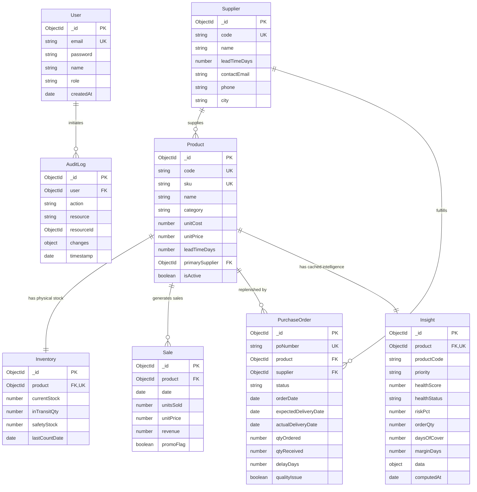

# 06. Database & API Reference Guide

This document provides a complete technical specification for every MongoDB database collection and every REST API endpoint across both the Express backend and the Python FastAPI service.

---

## 1. Database Architecture & Entity Relationship Diagram (ERD)

The operational database is **MongoDB** (accessed via **Mongoose 9**). It manages 8 distinct collections:



---

## 2. MongoDB Collection Schemas & Example Documents

### 2.1. `users` Collection (`server/src/models/User.js`)
Stores user accounts for authentication and RBAC.

| Field | Type | Validation & Constraints | Description |
|---|---|---|---|
| `_id` | `ObjectId` | Auto-generated PK | Unique identifier |
| `email` | `String` | Required, Unique, Lowercase, Trimmed | Account email address |
| `password` | `String` | Required | bcrypt hash (10 rounds) |
| `name` | `String` | Optional, Trimmed | Full display name |
| `role` | `String` | Enum: `['admin', 'manager', 'staff']` | Access control role (default: `'staff'`) |
| `createdAt` | `Date` | Default: `Date.now` | Account creation timestamp |

```json
{
  "_id": "671aa10123456789abcdef01",
  "email": "manager@inventory.com",
  "password": "$2a$10$e7V.X8f9y0Z1A2B3C4D5E6F7G8H9I0J1K2L3M4N5O6P7Q8R9S0T1U",
  "name": "Sarah Connor",
  "role": "manager",
  "createdAt": "2026-10-18T10:00:00.000Z"
}
```

---

### 2.2. `products` Collection (`server/src/models/Product.js`)
Catalog master directory.

| Field | Type | Validation & Constraints | Description |
|---|---|---|---|
| `_id` | `ObjectId` | Auto-generated PK | Unique identifier |
| `code` | `String` | Required, Unique, Indexed | Short code (e.g. `"P001"`) |
| `sku` | `String` | Required, Unique, Indexed | Stock Keeping Unit (e.g. `"SKU-USB-001"`) |
| `name` | `String` | Required, Trimmed | Commercial product title |
| `category` | `String` | Required, Indexed | Retail department |
| `unitCost` | `Number` | Required, $\ge 0$ | Procurement cost per unit ($) |
| `unitPrice` | `Number` | Required, $\ge 0$ | Retail selling price per unit ($) |
| `leadTimeDays`| `Number` | Required, $\ge 1$ | Nominal supplier delivery lead time |
| `primarySupplier`| `ObjectId` | Reference: `Supplier` | Primary designated vendor |
| `isActive` | `Boolean` | Default: `true` | Soft deletion flag |

```json
{
  "_id": "671aa20123456789abcdef02",
  "code": "P001",
  "sku": "SKU-USB-001",
  "name": "USB Hub 4-Port",
  "category": "Accessories",
  "unitCost": 12.50,
  "unitPrice": 24.99,
  "leadTimeDays": 7,
  "primarySupplier": "671aa30123456789abcdef03",
  "isActive": true
}
```

---

### 2.3. `inventories` Collection (`server/src/models/Inventory.js`)
Physical warehouse stock tracking.

| Field | Type | Validation & Constraints | Description |
|---|---|---|---|
| `_id` | `ObjectId` | Auto-generated PK | Unique identifier |
| `product` | `ObjectId` | Required, Unique, Ref: `Product` | Single inventory record per SKU |
| `currentStock` | `Number` | Required, $\ge 0$, Default: `0` | Physical units on warehouse shelves |
| `inTransitQty` | `Number` | Required, $\ge 0$, Default: `0` | Units ordered in open purchase orders |
| `safetyStock` | `Number` | Required, $\ge 0$, Default: `0` | Calculated buffer reserve |
| `lastCountDate` | `Date` | Default: `Date.now` | Date of last physical cycle audit |

```json
{
  "_id": "671aa40123456789abcdef04",
  "product": "671aa20123456789abcdef02",
  "currentStock": 40,
  "inTransitQty": 85,
  "safetyStock": 22,
  "lastCountDate": "2026-10-26T00:00:00.000Z"
}
```

---

### 2.4. `sales` Collection (`server/src/models/Sale.js`)
Point-of-sale daily transaction log.

| Field | Type | Validation & Constraints | Description |
|---|---|---|---|
| `_id` | `ObjectId` | Auto-generated PK | Unique identifier |
| `product` | `ObjectId` | Required, Indexed, Ref: `Product` | Associated product SKU |
| `date` | `Date` | Required, Indexed | Transaction calendar date |
| `unitsSold` | `Number` | Required, Integer $\ge 0$ | Total units sold on this date |
| `unitPrice` | `Number` | Required, $\ge 0$ | Price at transaction time |
| `revenue` | `Number` | Required, $\ge 0$ | Computed: `unitsSold * unitPrice` |
| `promoFlag` | `Boolean` | Default: `false` | True if promotional discount active |

**Index:** Compound unique index on `{ product: 1, date: 1 }`.

```json
{
  "_id": "671aa50123456789abcdef05",
  "product": "671aa20123456789abcdef02",
  "date": "2026-10-25T00:00:00.000Z",
  "unitsSold": 18,
  "unitPrice": 24.99,
  "revenue": 449.82,
  "promoFlag": false
}
```

---

### 2.5. `purchaseorders` Collection (`server/src/models/PurchaseOrder.js`)
Procurement tracking.

| Field | Type | Validation & Constraints | Description |
|---|---|---|---|
| `_id` | `ObjectId` | Auto-generated PK | Unique identifier |
| `poNumber` | `String` | Required, Unique, Indexed | Identifier (e.g. `"PO-0395"`) |
| `product` | `ObjectId` | Required, Ref: `Product` | SKU being replenished |
| `supplier` | `ObjectId` | Required, Ref: `Supplier` | Delivering vendor |
| `status` | `String` | Enum: `['Pending', 'Approved', 'In Transit', 'Delivered', 'Cancelled']` | Order state |
| `orderDate` | `Date` | Default: `Date.now` | Creation timestamp |
| `expectedDeliveryDate` | `Date` | Required | Promised delivery date |
| `actualDeliveryDate` | `Date` | Optional | Date shipment arrived |
| `qtyOrdered` | `Number` | Required, Integer $> 0$ | Units purchased |
| `qtyReceived` | `Number` | Integer $\ge 0$, Default: `0` | Physical units received |
| `delayDays` | `Number` | Default: `0` | Calculated delivery delay (days) |
| `qualityIssue` | `Boolean` | Default: `false` | Shipment had damaged items |

```json
{
  "_id": "671aa60123456789abcdef06",
  "poNumber": "PO-20261026-P001",
  "product": "671aa20123456789abcdef02",
  "supplier": "671aa30123456789abcdef03",
  "status": "In Transit",
  "orderDate": "2026-10-26T09:30:00.000Z",
  "expectedDeliveryDate": "2026-11-02T00:00:00.000Z",
  "actualDeliveryDate": null,
  "qtyOrdered": 85,
  "qtyReceived": 0,
  "delayDays": 0,
  "qualityIssue": false
}
```

---

### 2.6. `insights` Collection (`server/src/models/Insight.js`)
Cache of ML intelligence calculations per product.

| Field | Type | Validation & Constraints | Description |
|---|---|---|---|
| `_id` | `ObjectId` | Auto-generated PK | Unique identifier |
| `product` | `ObjectId` | Required, Unique, Ref: `Product` | Single insight per SKU |
| `productCode` | `String` | Required, Indexed | E.g. `"P001"` |
| `priority` | `String` | Enum: `['Critical', 'High', 'Medium', 'Low']`, Indexed | Replenishment urgency |
| `healthScore` | `Number` | Number (0 to 100), Indexed | Composite inventory health |
| `healthStatus`| `String` | Enum: `['Critical', 'Warning', 'Healthy']` | Category tier |
| `riskPct` | `Number` | Number (0 to 100) | Calibrated stockout risk |
| `orderQty` | `Number` | Integer $\ge 0$ | Recommended replenishment units |
| `daysOfCover` | `Number` | Number $\ge 0$ | Days until stock reaches zero |
| `marginDays` | `Number` | Number | Cover minus delivery days |
| `data` | `Object` | Full nested JSON payload | Complete ML output payload |
| `computedAt` | `Date` | Default: `Date.now` | Calculation timestamp |

---

## 3. Express Backend API Endpoints (`server/src/routes/`)

All Express endpoints (except public authentication and health checks) require the HTTP header:
`Authorization: Bearer <JWT_TOKEN>`

| Method | URL | Auth Role | Description | Controller / Handler | UI Caller Component |
|---|---|---|---|---|---|
| `GET` | `/api/health` | Public | Backend health & DB ping | `routes/health.js` | Dev tools / Status bar |
| `POST` | `/api/auth/register` | Public | Register new staff user | `authController.js::register` | `pages/Login.jsx` |
| `POST` | `/api/auth/login` | Public | Login with email/password | `authController.js::login` | `pages/Login.jsx` |
| `GET` | `/api/auth/me` | Any | Fetch current user session | `authController.js::getMe` | `AuthProvider.jsx` |
| `GET` | `/api/products` | Any | List catalog products (paginated) | `crudFactory.js::list` | `pages/ProductList.jsx` |
| `GET` | `/api/products/:id` | Any | Get product details | `crudFactory.js::getOne` | `pages/ProductForm.jsx` |
| `POST` | `/api/products` | Admin, Mgr | Create catalog product | `crudFactory.js::createOne` | `pages/ProductForm.jsx` |
| `PUT` | `/api/products/:id` | Admin, Mgr | Update catalog product | `crudFactory.js::updateOne` | `pages/ProductForm.jsx` |
| `DELETE`| `/api/products/:id` | Admin | Delete catalog product | `crudFactory.js::deleteOne` | `pages/ProductList.jsx` |
| `GET` | `/api/inventory` | Any | List inventory ledger | `crudFactory.js::list` | `pages/InventoryList.jsx` |
| `PUT` | `/api/inventory/:id`| Staff, Mgr, Admin | Update physical stock count | `crudFactory.js::updateOne` | `pages/InventoryForm.jsx` |
| `GET` | `/api/sales` | Any | List sales transactions | `crudFactory.js::list` | `pages/SaleList.jsx` |
| `POST` | `/api/sales` | Staff, Mgr, Admin | Record point-of-sale transaction | `crudFactory.js::createOne` | `pages/SaleForm.jsx` |
| `GET` | `/api/suppliers` | Any | List suppliers | `crudFactory.js::list` | `pages/SupplierList.jsx` |
| `POST` | `/api/suppliers` | Admin, Mgr | Add new supplier | `crudFactory.js::createOne` | `pages/SupplierForm.jsx` |
| `GET` | `/api/purchase-orders` | Any | List purchase orders | `crudFactory.js::list` | `pages/PurchaseOrderList.jsx` |
| `POST` | `/api/purchase-orders` | Admin, Mgr | Create new purchase order | `routes/purchaseOrders.js` | `pages/PurchaseOrderForm.jsx` |
| `PUT` | `/api/purchase-orders/:id`| Admin, Mgr | Update PO (delivers & stocks) | `routes/purchaseOrders.js` | `pages/PurchaseOrderForm.jsx` |
| `GET` | `/api/insights` | Any | List cached insight summaries | `insightsController.js::listInsights` | `Dashboard.jsx`, `Alerts.jsx`, `SmartReorder.jsx` |
| `GET` | `/api/insights/:code` | Any | Compute & store single SKU insight | `insightsController.js::getInsight` | `pages/ProductInsight.jsx` |
| `GET` | `/api/insights/:code/history`| Any | Get 52-week weekly demand series | `insightsController.js::getHistory` | `ForecastChart.jsx` |
| `GET` | `/api/insights/:code/explain`| Any | Get SHAP risk factor breakdown | `insightsController.js::getExplanation` | `WhyPanel.jsx` |
| `POST` | `/api/insights/refresh`| Admin, Mgr | Batch recalculate all 40 SKUs | `insightsController.js::refreshAll` | `Dashboard.jsx` ("Refresh Insights") |
| `GET` | `/api/supplier-risk`| Any | Fetch supplier reliability scorecard | `routes/supplierRisk.js` | `pages/SupplierRisk.jsx` |
| `GET` | `/api/anomalies` | Any | List Isolation Forest anomalies | `routes/anomalies.js` | `pages/Anomalies.jsx` |
| `POST` | `/api/simulator` | Any | Run What-If simulation (single SKU) | `routes/simulator.js` | `pages/Simulator.jsx` |
| `POST` | `/api/simulator/all`| Any | Run What-If simulation across all 40 | `routes/simulator.js` | `Assistant.jsx` (simulate_all tool) |
| `POST` | `/api/assistant` | Any | Execute autonomous AI chat tool loop | `routes/assistant.js` | `AssistantWidget.jsx`, `Assistant.jsx` |
| `GET` | `/api/ml-performance`| Any | Get holdout test model metrics | `routes/mlPerformance.js` | `pages/ModelPerformance.jsx` |

---

## 4. Python ML Service API Endpoints (`ml-service/app/`)

All Python FastAPI endpoints (except `/health`) require the HTTP header:
`X-Service-Token: <ML_SERVICE_TOKEN>`

| Method | URL | Request Body | Response Payload Summary | Python Handler Function | Called By Express Service |
|---|---|---|---|---|---|
| `GET` | `/health` | None | `{ status: "ok", timestamp: "..." }` | `app/main.py::health` | `mlService.js::health` |
| `POST`| `/forecast` | `{ product_id, promo_days, price }` | 3-week point forecasts & 80% intervals | `routes_forecast.py::forecast` | `mlService.js::forecast` |
| `POST`| `/risk` | `{ product_id, stock }` | Calibrated stockout risk %, signals | `routes_risk.py::risk` | `mlService.js::risk` |
| `GET` | `/risk/all` | None | Sorted array of stockout risks across all SKUs | `routes_risk.py::all_risks_endpoint`| `mlService.js::riskAll` |
| `POST`| `/trend` | `{ product_id }` | YoY trend, slope, seasonality, peak month | `routes_risk.py::trend` | `mlService.js::trend` |
| `POST`| `/insights` | `{ product_id, stock, on_order, expected_delivery_date }` | Combined forecast, risk, reorder, health, alerts | `routes_insights.py::insights` | `mlService.js::insights` |
| `GET` | `/insights/all` | None | Combined insights across all products | `routes_insights.py::all_insights_endpoint` | Internal testing / CLI |
| `GET` | `/supplier-risk`| None | Reliability scorecard table for all 8 suppliers | `routes_insights.py::supplier_risk_table` | `mlService.js::supplierRisk` |
| `POST`| `/explain` | `{ product_id, stock }` | SHAP factor groups, impact shares, reasons | `routes_explain.py::explain` | `mlService.js::explain` |
| `GET` | `/anomalies` | Query: `?days=90&kind=&limit=200` | Isolation Forest sales spikes & stock blips | `routes_explain.py::anomalies` | `mlService.js::anomalies` |
| `POST`| `/simulate` | `{ product_id, demand_pct, extra_delay_days, stock, order_qty }` | Before vs After comparison + 30-day projection | `routes_simulate.py::simulate_endpoint` | `mlService.js::simulate` |
| `POST`| `/simulate/all`| `{ demand_pct, extra_delay_days }`| Portfolio-wide simulation summary | `routes_simulate.py::simulate_all_endpoint` | `mlService.js::simulateAll` |
| `GET` | `/model-performance`| None | MAE, RMSE, MAPE, WAPE, F1, ROC-AUC metrics | `routes_performance.py::get_performance` | `mlService.js::performance` |
