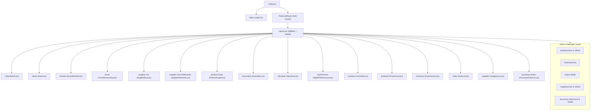
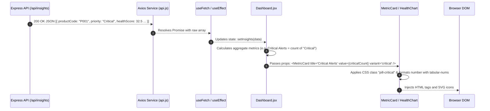
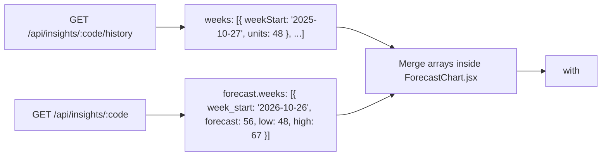

# 07. Frontend Architecture & Data Visualization Guide

This document provides a comprehensive guide to the client-side architecture (`client/`), explaining how React 19, Vite, Recharts, and Axios work together to turn raw backend JSON into an intuitive, responsive user interface.

---

## 1. Application Routing & Page Hierarchy

The application routing is configured in `client/src/App.jsx` using `react-router-dom` (v7). All page components are loaded asynchronously via `React.lazy()` for fast initial page load times.



---

## 2. Global State Management Architecture

State is cleanly partitioned into three tiers:

```
┌─────────────────────────────────────────────────────────────┐
│ 1. GLOBAL CONTEXT (App-Wide Session & Viewers)             │
│    • AuthProvider: JWT token, user profile, RBAC roles       │
│    • AssistantChatProvider: Chat conversation thread         │
│    • ProductImageViewerProvider: Fullscreen image preview   │
└──────────────────────────────┬──────────────────────────────┘
                               │
┌──────────────────────────────▼──────────────────────────────┐
│ 2. HOOKS LAYER (Data Fetching & Table Controllers)          │
│    • useList: Handles ?page, limit, search, sort, filters   │
│    • useFetch: Generic Promise resolver with loading/error  │
│    • useAssistantChat: Dispatches prompts to /api/assistant │
└──────────────────────────────┬──────────────────────────────┘
                               │
┌──────────────────────────────▼──────────────────────────────┐
│ 3. LOCAL COMPONENT STATE (Ephemeral UI State)               │
│    • Sliders, active tabs, modal open/close, sorting toggles│
└─────────────────────────────────────────────────────────────┘
```

### 2.1. `AuthProvider` (`client/src/context/AuthProvider.jsx`)
- Stores user identity `{ id, email, name, role }` and the raw JWT token.
- Reads `localStorage.getItem('token')` on initial mount to restore session without re-logging in.
- Provides `login(email, password)` and `logout()`.

### 2.2. `AssistantChatProvider` (`client/src/context/AssistantChatProvider.jsx`)
- Persists message history across page transitions so users can navigate to `/products` and return to the chat drawer without losing conversation history.
- Manages an array of messages:
  ```javascript
  {
    role: 'assistant',
    text: 'Raw response',
    facts: ['USB Hub stock is 40 units', 'Lead time is 7 days'],
    recommendation: 'Place an order for 84 units today.',
    toolsUsed: ['get_product_insight']
  }
  ```

---

## 3. Data Flow: From API JSON to Screen Pixels

Here is how data moves when rendering a dashboard card or table row:



---

## 4. Recharts Integration: Charts & Exact Data Feeds

The application uses **Recharts** (v2) for SVG-based reactive data visualization. Below are the three primary charts and the exact data shapes feeding them:

---

### 4.1. Multi-Horizon Forecast Chart (`ForecastChart.jsx`)
Displays 52 weeks of historical actual sales followed by 3 weeks of ML forecast, complete with an **80% prediction interval cone**.



#### Recharts Component Structure:
```jsx
<ResponsiveContainer width="100%" height={320}>
  <ComposedChart data={combinedSeries}>
    <CartesianGrid strokeDasharray="3 3" stroke="#e2e8f0" />
    <XAxis dataKey="weekLabel" />
    <YAxis />
    <Tooltip content={<CustomTooltip />} />

    {/* 80% Prediction Interval Shaded Band */}
    <Area
      type="monotone"
      dataKey="intervalBand" // = high - low
      baseValue="low"
      fill="#818cf8"
      fillOpacity={0.25}
      stroke="none"
      name="80% Prediction Interval"
    />

    {/* Actual Historical Demand */}
    <Line
      type="monotone"
      dataKey="actualUnits"
      stroke="#2563eb"
      strokeWidth={2}
      dot={false}
      name="Actual Demand"
    />

    {/* Machine Learning Forecast */}
    <Line
      type="monotone"
      dataKey="forecastUnits"
      stroke="#7c3aed"
      strokeWidth={2.5}
      strokeDasharray="4 4"
      dot={{ r: 4 }}
      name="ML Forecast"
    />
  </ComposedChart>
</ResponsiveContainer>
```

---

### 4.2. Health Score Component Breakdown (`HealthChart.jsx`)
Visualizes the 4 weighted pillars of the Inventory Health Score.

#### Data Feeding It:
`insight.health.components`:
```json
{
  "cover": 65.0,
  "risk": 80.0,
  "supplier": 85.0,
  "stability": 75.0
}
```

#### Recharts Component Structure:
Renders a horizontal stacked bar chart or four customized progress gauges showing:
- Stock Cover (Weight: 55%)
- Stockout Risk Buffer (Weight: 15%)
- Supplier Reliability (Weight: 15%)
- Demand Stability (Weight: 15%)

---

### 4.3. What-If 30-Day Inventory Projection Chart (`Simulator.jsx`)
Plots day-by-day simulated stock level over the next 30 days under user-adjusted demand shocks and supplier delays.

#### Data Feeding It:
`simulationResponse.after.projected_stock`: An array of 30 numbers representing warehouse stock at the close of each day:
`[42, 30, 18, 6, 0, 0, 0, 0, 0, 0, 60, 48, ...]`

#### Visual Alert:
The chart colors the line **red** whenever stock reaches `0` (stockout days) and displays a vertical reference line where a scheduled replacement order arrives.

---

### 4.4. 3x3 ABC-XYZ Matrix Component (`AbcXyzMatrix.jsx`)
An interactive grid of 9 cells:

| | **X (Steady)** | **Y (Variable)** | **Z (Erratic)** |
|---|---|---|---|
| **A (High Value)** | **AX** (High revenue, predictable) | **AY** (High revenue, seasonal) | **AZ** (High revenue, lumpy) |
| **B (Medium Value)** | **BX** (Medium revenue, steady) | **BY** (Medium revenue, seasonal)| **BZ** (Medium revenue, erratic)|
| **C (Low Value)** | **CX** (Low revenue, steady) | **CY** (Low revenue, seasonal) | **CZ** (Low revenue, erratic) |

#### Interactive Behavior:
Clicking any cell (e.g. `AZ`) updates the parent table filter to show only products matching `abc_xyz === 'AZ'`.
