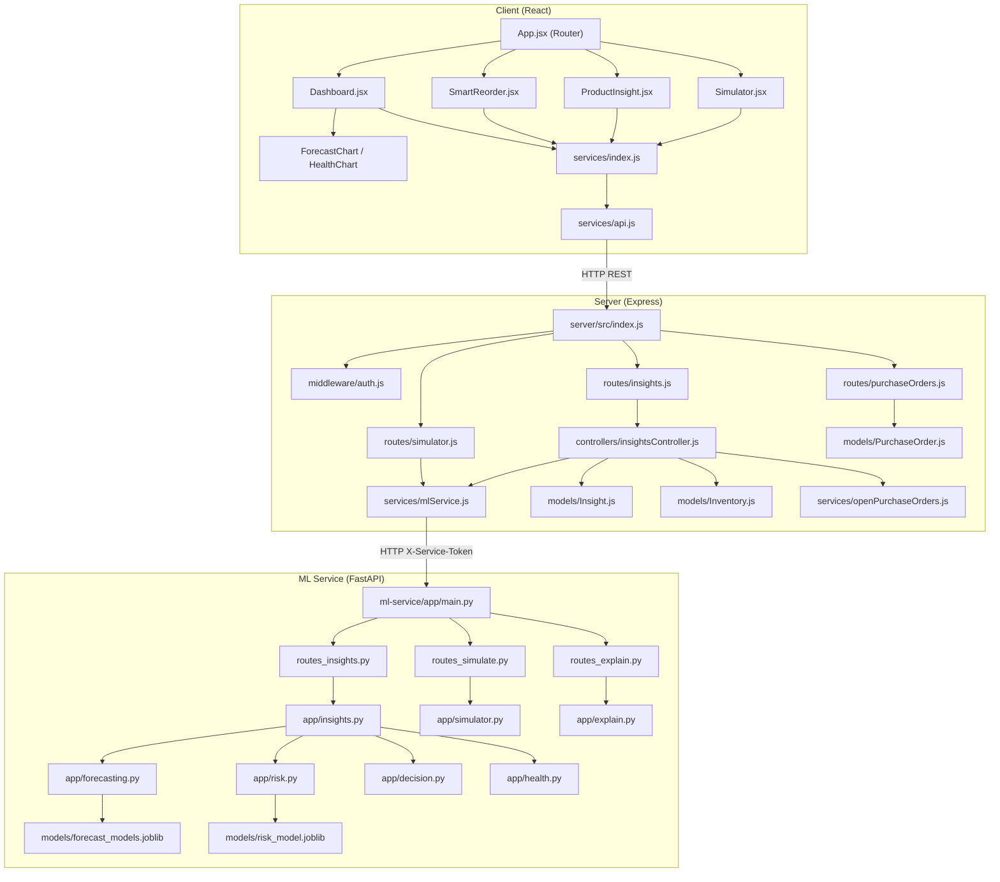
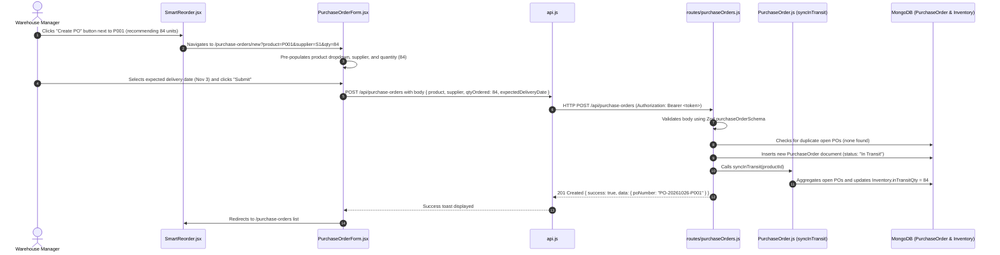
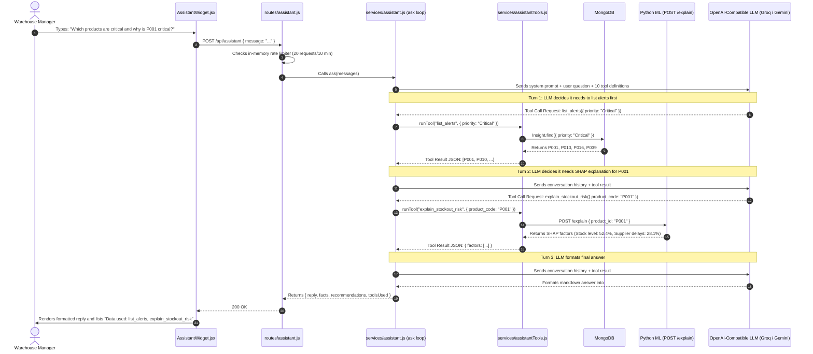
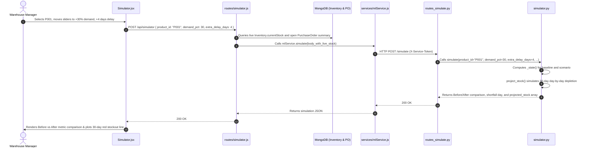

# 08. How Everything Connects: Dependency Map & Traces

This document provides a holistic look at the repository, featuring an architectural dependency map, 3 complete end-to-end walkthroughs of real-world user workflows, and a practical developer cheat sheet.

---

## 1. System Dependency Map

Below is a complete visual map illustrating how files in the client, server, and ML service import and depend on each other:

---

## 2. Three End-to-End Walkthroughs of Real User Actions

---

### Walkthrough 1: Creating a Purchase Order from Smart Reorder
**Scenario:** A warehouse manager notices that USB Hubs (P001) are low on stock, reviews the AI recommendation, and issues a purchase order to Supplier S1.

#### Files Involved in Walkthrough 1:
1. `client/src/pages/SmartReorder.jsx`: Displays the recommended reorder quantity (84 units) and renders a link to `/purchase-orders/new?product=P001&qty=84`.
2. `client/src/pages/PurchaseOrderForm.jsx`: Parses URL query parameters using `useSearchParams()`, fills form fields, and submits.
3. `client/src/services/api.js`: Injects JWT Bearer token into headers.
4. `server/src/routes/purchaseOrders.js`: Intercepts POST request, checks for existing open orders, and saves to MongoDB.
5. `server/src/models/PurchaseOrder.js::syncInTransit()`: Recalculates total open in-transit units and updates `Inventory.inTransitQty`.
6. `server/src/models/Inventory.js`: Persists new physical order exposure in MongoDB.

---

### Walkthrough 2: Asking the AI Assistant a Complex Supply Chain Question
**Scenario:** A manager opens the AI assistant drawer and asks: *"Which products are at critical risk right now, and why is P001 critical?"*

#### Files Involved in Walkthrough 2:
1. `client/src/components/AssistantWidget.jsx`: Captures user prompt and toggles chat drawer.
2. `server/src/routes/assistant.js`: Enforces per-user rate limit and dispatches to agent.
3. `server/src/services/assistant.js`: Orchestrates the iterative function-calling loop with the external LLM.
4. `server/src/services/assistantTools.js`: Executes `list_alerts` against MongoDB and `explain_stockout_risk` against Python FastAPI.
5. `ml-service/app/explain.py`: Runs `shap.TreeExplainer` on Random Forest model to calculate factor shares.

---

### Walkthrough 3: Running a What-If Demand Shock Simulation
**Scenario:** A manager navigates to `/simulator`, sets **Demand Shock to +30%**, sets **Extra Supplier Delay to +4 days**, and observes the projected stockout trajectory.

#### Files Involved in Walkthrough 3:
1. `client/src/pages/Simulator.jsx`: Renders input sliders and before/after comparison table.
2. `server/src/routes/simulator.js`: Validates input with Zod and injects live MongoDB warehouse stock.
3. `server/src/services/mlService.js`: Proxies request to Python service.
4. `ml-service/app/routes_simulate.py`: FastAPI route handler.
5. `ml-service/app/simulator.py`: Runs mathematical 30-day projection and recalculates health/reorder.

---

## 3. Developer Cheat Sheet: "If I Want to Change X, Which Files Do I Edit?"

Use this reference table whenever you need to add a feature, modify a formula, or fix an issue:

| What do you want to change? | Primary Files to Touch | Secondary Files to Verify |
|---|---|---|
| **Change the Safety Stock formula** (e.g. increase service level from 95% to 99%) | `ml-service/app/decision.py` (`Z_SERVICE = 2.33`) | `ml-service/app/risk.py`, `ml-service/tests/test_decision.py` |
| **Change Health Score weights or thresholds** | `ml-service/app/health.py` (`health_score`, `health_status`) | `ml-service/tests/test_health.py`, `client/src/components/HealthChart.jsx` |
| **Change Alert Margin thresholds** (e.g. Critical < 0 days) | `ml-service/app/health.py` (`alert_priority`), `ml-service/app/insights.py` | `client/src/pages/Alerts.jsx`, `server/src/controllers/insightsController.js` |
| **Add a new field to Product catalog** (e.g. `barcode` or `brand`) | `server/src/models/Product.js`, `server/src/validators/schemas.js` | `client/src/pages/ProductForm.jsx`, `client/src/pages/ProductList.jsx` |
| **Change user roles or add a new role** (e.g. `'auditor'`) | `server/src/models/User.js`, `server/src/middleware/auth.js` | `client/src/components/ProtectedRoute.jsx`, `client/src/context/AuthProvider.jsx` |
| **Retrain the Demand Forecasting model** | Run `python -m app.train_forecast` inside `ml-service/` | `ml-service/models/forecast_models.joblib`, `forecast_metrics.json` |
| **Retrain the Stockout Risk Classifier** | Run `python -m app.train_risk` inside `ml-service/` | `ml-service/models/risk_model.joblib`, `risk_metrics.json` |
| **Add a new tool for the AI Assistant** | `server/src/services/assistantTools.js` (add tool definition & handler) | `server/src/services/assistant.js` (`SYSTEM_PROMPT`) |
| **Change the chart colors or font styles** | `client/src/index.css` (CSS variables), `client/src/components/ForecastChart.jsx` | `client/src/components/HealthChart.jsx` |
| **Change minimum order quantity (MOQ) logic** | `ml-service/app/decision.py` (`smart_reorder`, `moq` parameter) | `client/src/pages/SmartReorder.jsx` |
