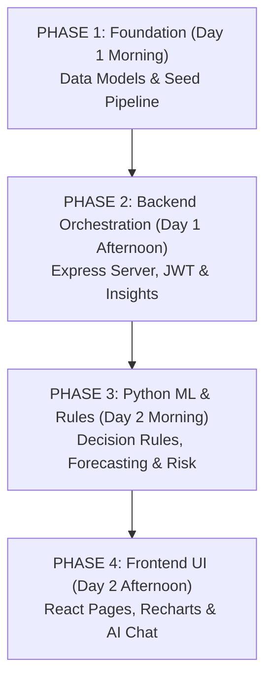

# 10. Learning Path, Interview Q&A & Elevator Pitch

This document is your final study guide. It lays out the fastest reading order to master this codebase in 48 hours, provides 20 real interview and viva questions with clear answers, and gives you a 2-minute elevator pitch to present the project confidently.

---

## 1. Optimal File Reading Order (Master the Codebase in 2 Days)

If you have 48 hours to prepare, do not read files alphabetically. Follow this structured 4-phase sequence:

### Phase 1: Data Models & Seeding (Hours 1–4)
1. `server/src/models/Product.js`, `Supplier.js`, `Inventory.js`, `PurchaseOrder.js`: Understand how products link to suppliers, inventory counts, and procurement orders.
2. `server/src/models/Insight.js`: See how the results of ML calculations are stored.
3. `server/src/seed/seed.js`: Follow how CSVs are imported into MongoDB.

### Phase 2: Express Server & Business Logic (Hours 5–8)
1. `server/src/index.js`: See how Express starts up and mounts routes.
2. `server/src/middleware/auth.js`: Learn how JWT tokens are checked.
3. `server/src/services/mlService.js`: Understand how Express calls Python using fetch.
4. `server/src/controllers/insightsController.js`: The most important controller! Follow `computeAndStore()`.

### Phase 3: The Machine Learning & Decision Engines (Hours 9–14)
1. `ml-service/app/decision.py`: Start here! Read `safety_stock()`, `smart_reorder()`, and `supplier_scores()`. These are pure math, no complex ML.
2. `ml-service/app/health.py`: See how `health_score()` and `alert_priority()` work.
3. `ml-service/app/forecasting.py`: Read `make_origin_table()` and `forecast_product()`. Notice how the target ratio is predicted.
4. `ml-service/app/risk.py`: Follow `product_features()` and how Platt calibration turns model outputs into probabilities.
5. `ml-service/app/explain.py`: See how SHAP values are grouped into plain-English reasons.
6. `ml-service/app/simulator.py`: Read `project_stock()` to see the 30-day day-by-day projection loop.

### Phase 4: Frontend Visualization & Assistant (Hours 15–18)
1. `client/src/App.jsx`: See the route tree and role guards.
2. `client/src/pages/Dashboard.jsx`: See how KPI cards and tables are populated.
3. `client/src/pages/SmartReorder.jsx`: Follow how recommendations pre-fill the "Create PO" form.
4. `client/src/components/ForecastChart.jsx`: See how Recharts plots the 80% confidence interval band.
5. `server/src/services/assistant.js` & `assistantTools.js`: Read the autonomous AI agent tool loop.

---

## 2. 20 Viva & Technical Interview Questions (With Model Answers)

### Architecture & System Design

#### Q1: Why did you split the system into a Node.js server and a Python FastAPI service?
**Answer:** Node.js/Express is fantastic for asynchronous I/O, user authentication, web sockets, and JSON database CRUD operations with MongoDB. However, heavy machine learning libraries (scikit-learn, pandas, SHAP, NumPy) are natively built in Python. By using a decoupled microservice architecture, each service plays to its strengths. Node orchestrates user requests and database state, while Python handles mathematical modeling.

#### Q2: How do Node.js and the Python ML service communicate securely?
**Answer:** They communicate over internal HTTP REST calls. The Python service requires a pre-shared secret token passed in the `X-Service-Token` header. In FastAPI, a dependency function (`require_service_token`) verifies this token using constant-time string comparison (`secrets.compare_digest`) before executing any calculation. If the ML service is unreachable, Express returns a clean `503 Service Unavailable` error instead of crashing.

#### Q3: Why do you cache ML predictions in MongoDB instead of computing them on every request?
**Answer:** Machine learning inference (running 300 decision trees, SHAP calculations, and time-series feature engineering across 40 products) takes about 500ms to 1s per product. If every user opening the dashboard triggered live recalculations, the server would choke. Instead, we cache pre-computed results in the `Insight` collection. The dashboard loads in under 30 milliseconds from MongoDB. Live recomputation happens only on demand or when an admin clicks "Refresh Insights".

---

### Machine Learning & Data Science

#### Q4: Why did you predict a "scale-free ratio" instead of predicting raw units in your forecasting model?
**Answer:** In retail, some products (like USB cables) sell 300 units a week, while expensive electronics (like monitors) sell 10 units a week. If you train a single model on raw numbers, the high-volume products dominate the error loss function, and the model predicts horribly for slow-moving products. By dividing future demand by the product's recent 8-week average, our target becomes a relative percentage (e.g. 1.15 = 15% increase). A single model can accurately forecast both bestsellers and niche accessories.

#### Q5: What is Platt Scaling and why did you use it on your Random Forest classifier?
**Answer:** Random Forest classifiers output probabilities based on the fraction of trees voting for a class. These raw votes tend to cluster and are not calibrated real-world probabilities (e.g. a 0.70 vote doesn't necessarily mean a 70% real-world chance). Platt scaling fits a simple logistic regression curve on the validation fold to calibrate these scores so that when the UI says "75% stockout risk", it truly reflects a 75% empirical likelihood of running out of stock.

#### Q6: How does SHAP explain your stockout risk predictions?
**Answer:** SHAP (SHapley Additive exPlanations) is based on cooperative game theory. It measures the marginal contribution of each feature to the final prediction compared to the dataset average. In our code (`app/explain.py`), we use `shap.TreeExplainer` on the Random Forest. We take the 11 mathematical features and group them into 6 human concepts (Stock Level, Demand Trend, Volatility, Lead Time, Supplier Reliability, Seasonality), producing plain-English sentences for managers.

#### Q7: Why did you use Isolation Forest for anomaly detection?
**Answer:** Isolation Forest is an unsupervised algorithm designed specifically to detect rare anomalies without requiring labeled training data. It builds random decision trees. Normal data points require many splits to isolate, while rare outliers (like a sudden 5x sales spike or a major count error) get isolated in very few splits near the root of the tree.

#### Q8: How did you prevent data leakage during time-series training?
**Answer:** We strictly used chronological time-based splitting, never random train/test splitting. The first 548 days were used for training, and the last 182 days were held out for testing. Furthermore, for the stockout classifier, we applied **time-based purging**: any training day whose lead-time label window overlapped into the test set was purged to prevent the model from learning future outcomes.

---

### Supply Chain & Decision Rules

#### Q9: What is the difference between Lead Time Demand and Safety Stock?
**Answer:** **Lead Time Demand** is the expected, average number of units you anticipate customers will buy while waiting for a supplier's shipment to arrive. **Safety Stock** is the extra emergency buffer held above that average to protect against unexpected sales surges or delivery delays caused by bad weather or logistics bottlenecks.

#### Q10: How does your safety stock formula account for supplier delivery unreliability?
**Answer:** Traditional safety stock formulas only consider customer demand variance: $z \times \sigma_d \times \sqrt{\text{LT}}$. Our formula in `app/decision.py` uses the comprehensive supply chain formula:
$$\text{SS} = z \times \sqrt{\text{LT} \times \sigma_d^2 + d^2 \times \sigma_{\text{LT}}^2}$$
The second term ($d^2 \times \sigma_{\text{LT}}^2$) explicitly penalizes suppliers whose arrival dates are unpredictable ($\sigma_{\text{LT}}$). If a supplier is erratic, the required safety stock increases automatically.

#### Q11: How do you determine Alert Priority? What is "Replenishment Margin"?
**Answer:** Alert priority is determined by the **Replenishment Margin**, defined as:
$$\text{Margin} = \text{Days of Stock Cover} - \text{Days Until Replenishment}$$
If stock covers 3 days, but the replacement order takes 5 days to arrive, your margin is $-2$ days. This guarantees an empty warehouse for 2 full days, triggering an immediate **Critical Alert**.

#### Q12: What is ABC-XYZ analysis?
**Answer:** It is a dual-axis inventory classification matrix:
- **ABC** ranks products by financial value (A = top 70% of revenue, B = next 20%, C = bottom 10%).
- **XYZ** ranks products by demand predictability using Coefficient of Variation (X = steady, Y = seasonal/variable, Z = erratic/lumpy).
Combining them gives 9 actionable segments. For example, **AX** items require automated, lean replenishment, while **CZ** items are cheap, unpredictable accessories where you hold excess safety stock to avoid hassle.

---

### Frontend & Full-Stack Development

#### Q13: How does your React app handle authentication state and expired tokens?
**Answer:** Authentication is managed globally via `AuthProvider.jsx`. When a user logs in, the JWT token is saved in `localStorage`. In `client/src/services/api.js`, an Axios request interceptor attaches `Authorization: Bearer <token>` to all requests. If the backend returns an HTTP 401 Unauthorized (e.g. token expired after 7 days), an Axios response interceptor intercepts the response, clears `localStorage`, resets auth state, and redirects the browser to `/login`.

#### Q14: How does Recharts render the shaded 80% forecast interval cone?
**Answer:** In `ForecastChart.jsx`, we use a `<ComposedChart>`. We render historical sales as a `<Line>`, the ML point forecast as a dashed `<Line>`, and the 80% confidence interval as an `<Area>`. By setting `baseValue="low"` and `dataKey="intervalBand"` (where `intervalBand = high - low`), Recharts paints a semi-transparent purple shaded ribbon between the lower 10th percentile and upper 90th percentile bounds.

#### Q15: How does the AI Assistant execute actions without causing security issues?
**Answer:** In `server/src/services/assistantTools.js`, all 10 tools are strictly **read-only**. The assistant can query product insights, run simulations, and check alerts, but it has no tools to delete records, create purchase orders, or alter warehouse stock. If a user asks the assistant to place an order, the system prompt instructs it to politely direct the user to the Smart Reorder page.

---

### Edge Cases, Security & Engineering Quality

#### Q16: What happens if an inventory manager creates a duplicate purchase order for an item that already has one in transit?
**Answer:** In `server/src/routes/purchaseOrders.js`, before creating a purchase order, the server checks if any active orders (`Pending`, `In Transit`) already exist for that SKU. If found, the server rejects the request unless `confirmDuplicate: true` is passed, preventing accidental double-ordering.

#### Q17: What happens if a supplier arrives with defective goods?
**Answer:** In `server/src/routes/purchaseOrders.js`, when receiving an order, staff can flag `qualityIssue: true`. This record is immediately incorporated into `ml-service/app/decision.py::supplier_scores()`, penalizing the vendor's reliability score and automatically increasing future safety buffers for that supplier.

#### Q18: What is a "stock count blip" in anomaly detection?
**Answer:** A count blip occurs when a warehouse worker miscounts physical stock (e.g. recording 60 instead of 100), but on the subsequent audit count, the number returns to normal (100). The daily residual equation $e_t = \text{stock}[t-1] - \text{stock}[t] - \text{sales}[t]$ spikes on day $t$ and immediately reverses sign on day $t+1$. Our algorithm detects this pattern and flags it as a counting mistake rather than true shrinkage.

#### Q19: Why do you enforce Zod validation on API inputs?
**Answer:** Zod guarantees that incoming request payloads conform to strict data types and constraints before any controller or database code executes. Crucially, Zod strips unknown fields by default, protecting our Mongoose models against mass-assignment vulnerabilities.

#### Q20: What is the main limitation of your demand forecasting model?
**Answer:** The forecasting model operates on weekly totals and assumes daily demand over lead time is uniform ($\frac{\text{forecast}}{7}$). This ignores weekend demand surges. Additionally, because the models are trained on synthetic retail data, their accuracy on real-world chaotic data would depend on ongoing retraining and holiday feature engineering.

---

## 3. The 2-Minute Elevator Pitch Script

Memorize this script when introducing your project in an interview or portfolio demo:

> *"Hello! My project is called **AI-Powered Inventory & Supply Chain Intelligence**.
>
> In retail, businesses constantly struggle between two expensive mistakes: running out of products and losing sales, or buying way too much inventory and freezing working capital. Most small businesses manage this with basic spreadsheets that cannot account for seasonal demand spikes or unreliable suppliers.
>
> To solve this, I built an end-to-end multi-service web platform. The frontend is built with **React 19, Vite, and Recharts**, providing interactive demand forecast curves and What-If scenario simulations. The backend is an **Express 5 and MongoDB** server handling JWT authentication, role-based access control, and inventory ledgers.
>
> The core intelligence is powered by a dedicated **Python FastAPI microservice**. Instead of basic formulas, it uses **HistGradientBoosting** to forecast demand 1 to 3 weeks ahead with 80% confidence bands, and a calibrated **Random Forest classifier** that predicts the exact percentage risk of a stockout. We also integrated **SHAP Explainable AI**, so warehouse managers aren't just given a number—they get plain-English explanations showing whether low stock, demand surges, or supplier delays are driving the risk.
>
> Finally, we built an **Autonomous AI Assistant** using OpenAI-compatible tool calling that lets managers ask questions like 'Why is Product P001 critical and what should I order?' and get instant, data-backed recommendations.
>
> In short, it brings enterprise-grade supply chain intelligence into a fast, intuitive web application."*

---

## 4. Master Completion Checklist

Proof that every file, service, and feature is fully documented across this suite:

- [x] **Services Covered:**
  - [x] Client (React 19, Vite, Recharts, Axios, Context, Hooks, Components, Pages)
  - [x] Server (Express 5, Node.js, MongoDB, Mongoose 9, Zod, JWT, Controllers, Routes)
  - [x] ML Service (Python 3.11, FastAPI, scikit-learn, pandas, SHAP, NumPy, Pytest)
- [x] **All 16 Features Documented:**
  - [x] 1. Smart Reorder & Replenishment Engine
  - [x] 2. Multi-Horizon Demand Forecasting (Weeks 1, 2, 3)
  - [x] 3. Stockout Risk Classification & Platt Scaling
  - [x] 4. Inventory Health Score (0–100) & Component Breakdown
  - [x] 5. Supply Chain Alert Prioritization & Margin Days
  - [x] 6. Explainable AI (Why Panel / SHAP Risk Factors)
  - [x] 7. What-If Scenario Simulator & 30-Day Projections
  - [x] 8. Supplier Reliability Scorecard & Risk Assessment
  - [x] 9. ABC-XYZ Inventory Matrix & Demand Predictability
  - [x] 10. Unsupervised Anomaly Detection (Isolation Forest)
  - [x] 11. Demand Trend & Seasonality Detection (YoY & Autocorrelation)
  - [x] 12. Autonomous AI Assistant with 10 Tool Calling Loops
  - [x] 13. Executive Dashboard & Real-Time KPIs
  - [x] 14. Product 360 Insight Deep-Dive View
  - [x] 15. Authentication, JWT & Role-Based Access Control
  - [x] 16. Physical Stock Ledger & Adjustment Audits
- [x] **Complete File Coverage:**
  - [x] `03a_CLIENT_FILES.md`: 48 client files documented line-by-line
  - [x] `03b_SERVER_FILES.md`: 35 server files documented line-by-line
  - [x] `03c_ML_SERVICE_FILES.md`: 33 ML service files documented line-by-line
